# Array Techniques Explained

This document explains the array techniques and important array algorithms listed in the DSA roadmap. Each topic includes:

- Concept and intuition
- Common algorithm(s) used
- Time and space complexity
- Mermaid flow diagram

---

## 1. Reverse Array

### Explanation
Reversing an array means swapping elements from the left and right ends until the entire array is mirrored.

This is a classic in-place operation and is useful when solving questions like:

- Reverse a list
- Check if an array is a palindrome
- Prepare an array for two-pointer logic

### Algorithm
Use two pointers:

- `left = 0`
- `right = arr.length - 1`
- While `left < right`, swap `arr[left]` and `arr[right]`
- Move `left += 1`, `right -= 1`

### Time and Space Complexity
- Time: O(n)
- Space: O(1)

### Flow Diagram
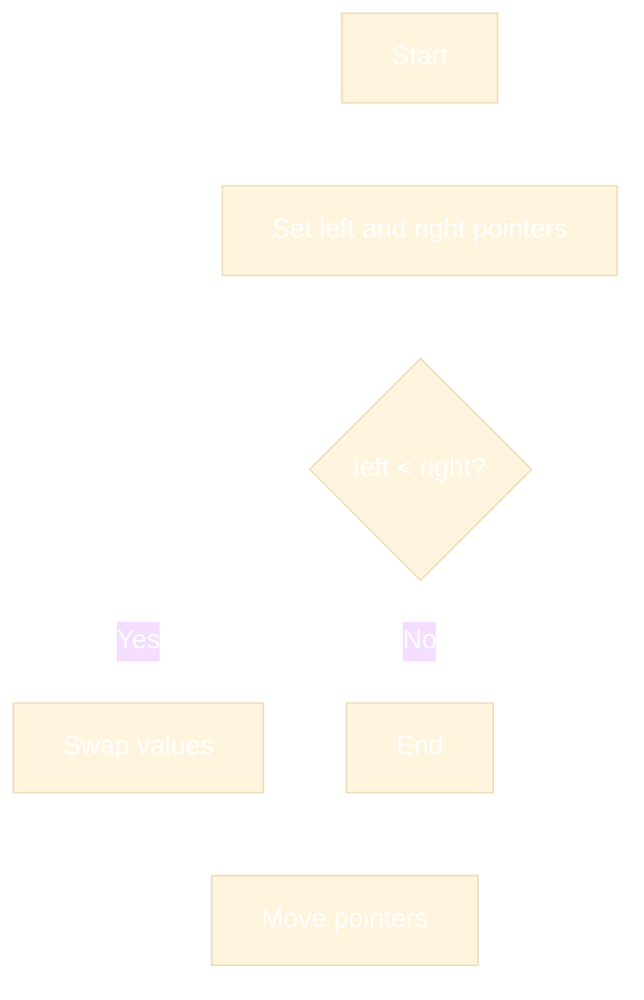

---

## 2. Rotate Array

### Explanation
Rotating an array shifts all elements to the left or right by a given number of steps. This is common in interview questions and optimization problems.

Example:

- ` [1,2,3,4,5,6] ` rotated left by 2 becomes `[3,4,5,6,1,2]`

### Algorithms
#### A. Reversal Method (Most efficient)
1. Reverse the first `k` elements
2. Reverse the remaining `n-k` elements
3. Reverse the whole array

This works for both left and right rotation.

#### B. Cyclic Reordering
Use a temporary array or rotate element by element.

### Time and Space Complexity
- Time: O(n)
- Space: O(1) using reversal method
- Space: O(n) using auxiliary array method

### Flow Diagram
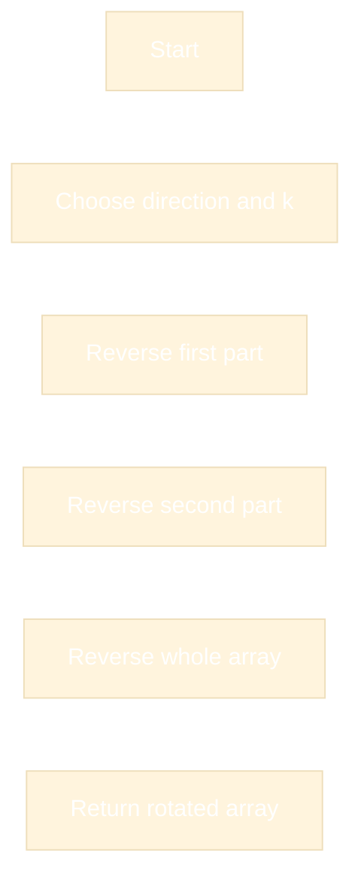

---

## 3. Merge Arrays

### Explanation
Merging arrays combines two arrays into a single array, either by creating a new array or inserting one into another.

Common forms:

- Merge sorted arrays
- Merge arrays of different sizes
- Concatenate arrays

### Algorithms
#### A. Simple concatenation
Use loops or built-in methods to append values.

#### B. Merge two sorted arrays
Use a two-pointer technique:

- Compare current elements from both arrays
- Insert the smaller one into the result
- Move the pointer forward

### Time and Space Complexity
- Concatenate/append: O(n + m) time, O(n + m) space if new array is created
- Merge sorted arrays with two pointers: O(n + m) time, O(n + m) extra space

### Flow Diagram
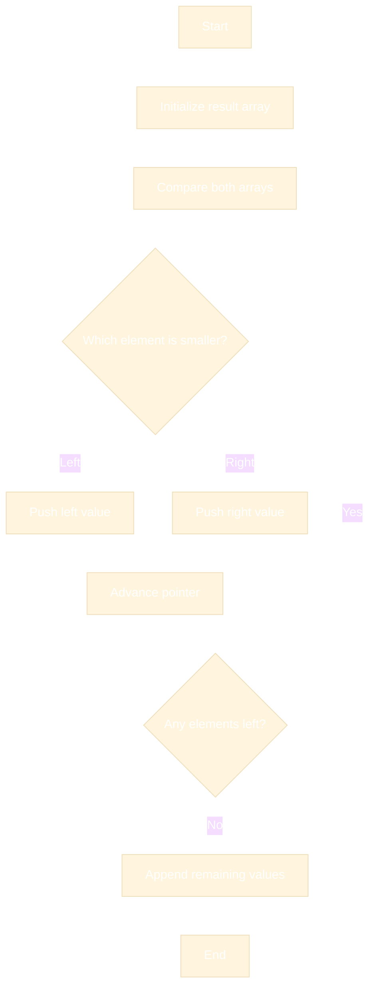

---

## 4. Frequency Counting

### Explanation
Frequency counting means counting how many times each value appears in an array.

It is used in problems such as:

- Finding duplicates
- Checking anagrams
- Counting most frequent element
- Comparing arrays

### Algorithms
- Hash map / object / `Map`
- Frequency array when values are in a bounded range

Example:

```ts
const freq: Record<number, number> = {};
for (const x of arr) {
  freq[x] = (freq[x] || 0) + 1;
}
```

### Time and Space Complexity
- Time: O(n)
- Space: O(k), where `k` is the number of distinct values

### Flow Diagram
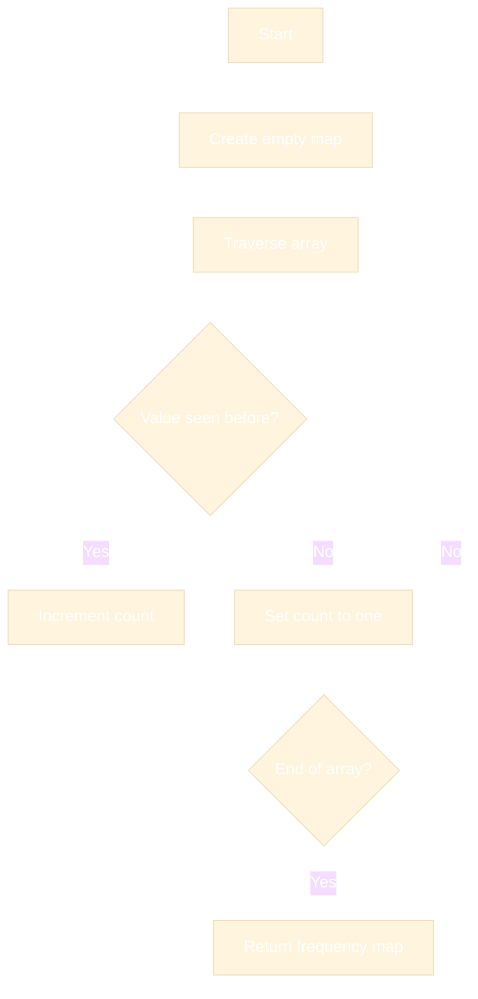

---

## 5. Prefix Sums

### Explanation
A prefix sum array stores cumulative sums of elements from the start of the array.

`prefix[i] = arr[0] + arr[1] + ... + arr[i]`

This helps answer queries like:

- Sum of a subarray
- Check equality conditions
- Find range sums quickly

### Algorithm
For each index, compute:

```ts
prefix[i] = prefix[i - 1] + arr[i]
```

Then a subarray sum from `l` to `r` is:

```ts
sum(l, r) = prefix[r] - prefix[l - 1]
```

### Time and Space Complexity
- Building prefix sum: O(n)
- Querying range sum: O(1)
- Extra space: O(n)

### Flow Diagram
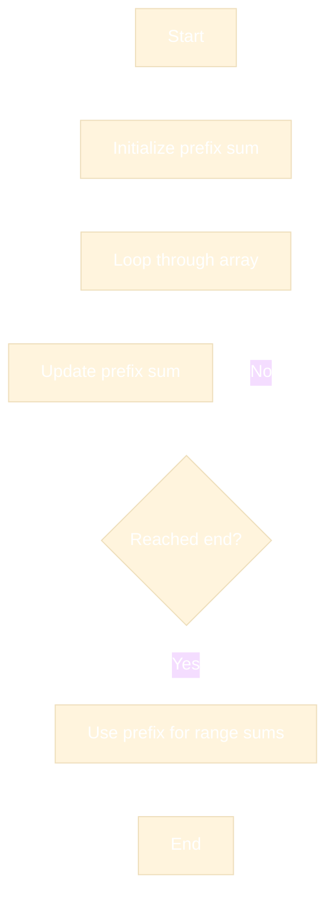

---

## 6. Suffix Sums

### Explanation
A suffix sum stores cumulative sums from an element to the end of the array.

`suffix[i] = arr[i] + arr[i+1] + ... + arr[n-1]`

This is useful when processing the array from the right side and when you need sums of elements after a given index.

### Algorithm
Compute from right to left:

```ts
suffix[i] = arr[i] + suffix[i + 1]
```

### Time and Space Complexity
- Time: O(n)
- Space: O(n) if stored separately
- Space can be O(1) if using a running sum while iterating from right, depending on use case

### Flow Diagram
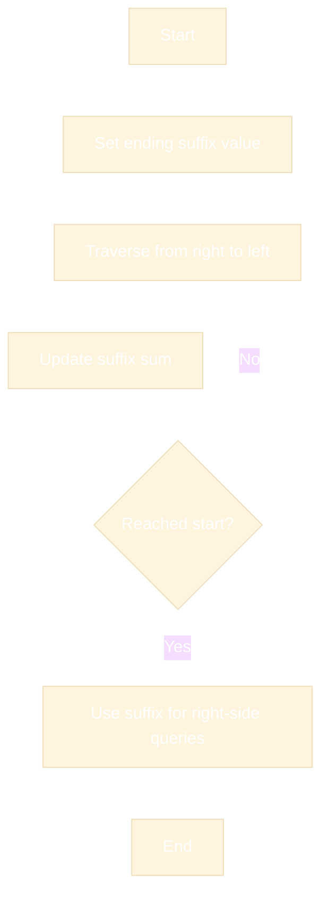

---

## 7. Difference Array

### Explanation
A difference array helps efficiently update ranges in an array.

Instead of updating every element in a range, we record the change at the endpoints.

This is especially useful in problems involving:

- Range increment operations
- Range add queries
- Event-based updates

### Algorithm
For an update on range `[l, r]` by `delta`:

```ts
diff[l] += delta;
diff[r + 1] -= delta;
```

After processing all updates, take a prefix sum of the difference array to obtain the final array.

### Time and Space Complexity
- Range update: O(1) per update
- Final array build: O(n)
- Total: O(n + q) for `q` updates
- Space: O(n)

### Flow Diagram
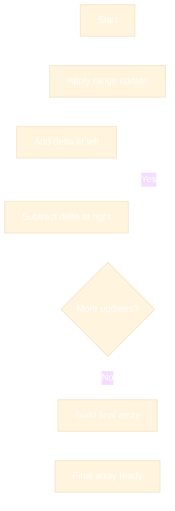

---

## 8. Subarrays

### Explanation
A subarray is a contiguous section of an array.

For an array of size `n`, there are:

- `n * (n+1) / 2` possible subarrays

Subarrays are important because many problems ask for:

- Sum of subarray
- Longest subarray satisfying a condition
- Largest subarray product/sum

### Algorithms
Common methods:

- Brute force: nested loops
- Prefix sums: for fast range sum queries
- Sliding window: for optimized constraints

### Time and Space Complexity
- Brute force check all subarrays: O(n²)
- Prefix sum optimization: O(n) preprocessing + O(1) query
- Space: O(n) for prefix array, O(1) extra if using running sums

### Flow Diagram
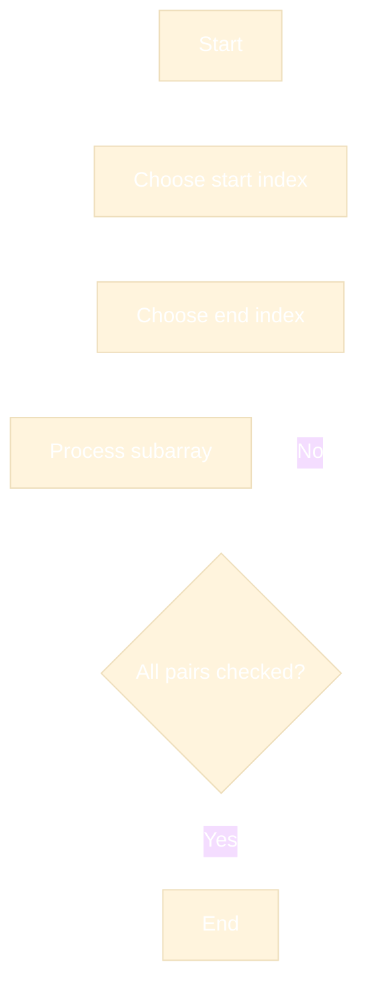

---

## 9. Maximum / Minimum Subarray

### Explanation
This technique finds the maximum or minimum sum/value over all subarrays.

Examples:

- Maximum subarray sum
- Minimum subarray sum
- Largest positive segment

### Algorithms
#### Kadane's Algorithm (for maximum subarray sum)
Keep a running sum:

- If current sum becomes negative, reset it to 0
- Track the maximum so far

Pseudo:

```ts
let curr = 0;
let best = arr[0];
for (const x of arr) {
  curr = Math.max(x, curr + x);
  best = Math.max(best, curr);
}
```

### Time and Space Complexity
- Time: O(n)
- Space: O(1)

### Flow Diagram
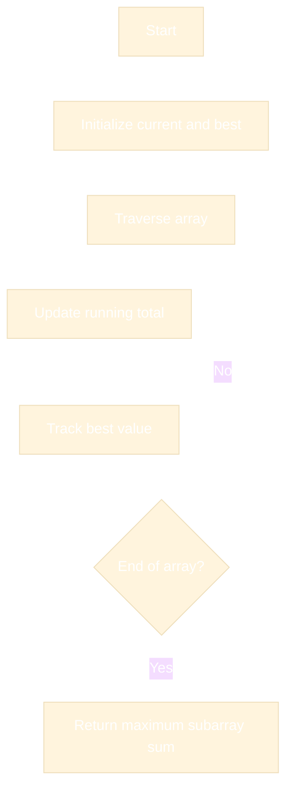

---

## 10. Matrix Traversal

### Explanation
Matrix traversal means visiting every element of a 2D array in a systematic order.

Common traversal patterns:

- Row-wise traversal
- Column-wise traversal
- Zigzag traversal
- Diagonal traversal

### Algorithms
Use nested loops:

```ts
for (let i = 0; i < rows; i++) {
  for (let j = 0; j < cols; j++) {
    process(matrix[i][j]);
  }
}
```

### Time and Space Complexity
- Time: O(rows × cols)
- Space: O(1) extra if traversing in place

### Flow Diagram
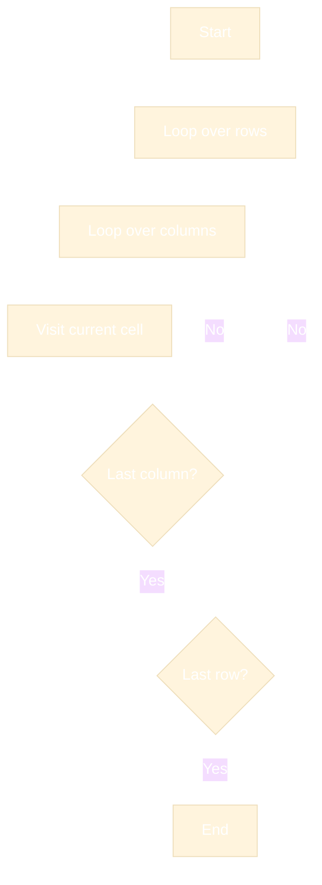

---

## 11. Spiral Matrix

### Explanation
Spiral traversal visits the matrix in a spiral order: top row, right column, bottom row, left column, then continues inward.

It is useful for:

- Matrix boundary traversal
- Print matrix in spiral order
- Grid-based problems

### Algorithm
Maintain boundaries:

- `top`
- `bottom`
- `left`
- `right`

Collect values while shrinking the boundaries in this order:

1. Top row
2. Right column
3. Bottom row
4. Left column

### Time and Space Complexity
- Time: O(rows × cols)
- Space: O(1) extra (ignoring output)

### Flow Diagram
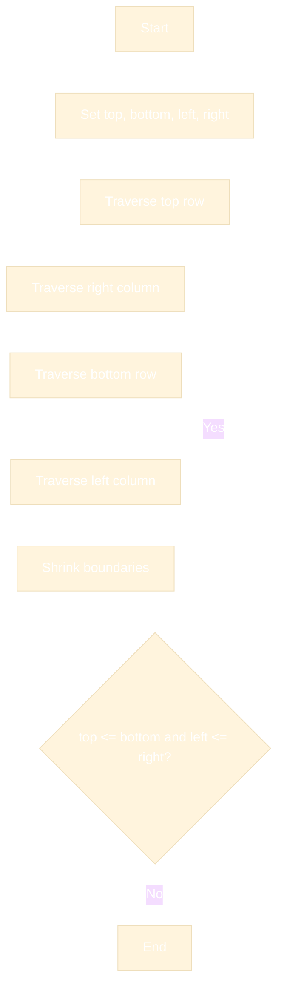

---

## 12. Diagonal Traversal

### Explanation
Diagonal traversal visits elements along diagonals of the matrix.

A matrix has two main diagonal directions:

- Main diagonal (`i == j`)
- Anti-diagonal (`i + j == constant`)

This is often used in matrix-themed problems and visual patterns.

### Algorithms
#### A. Traverse diagonals from top-left to bottom-right
For each diagonal, iterate row and column while staying inside bounds.

#### B. Traverse anti-diagonals
Use a constant sum `i + j` and collect elements sharing that sum.

### Time and Space Complexity
- Time: O(rows × cols)
- Space: O(1) extra if processed directly, O(rows × cols) if storing collected diagonals

### Flow Diagram
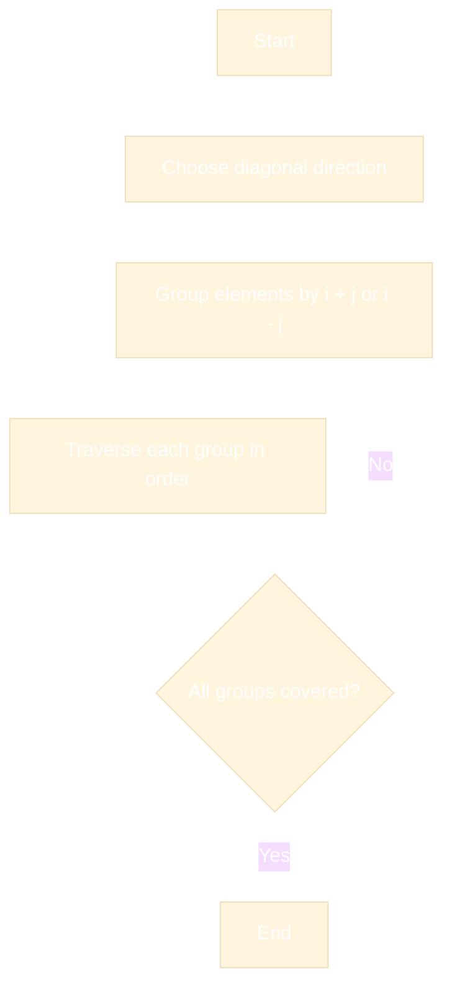

---

## 13. Kadane's Algorithm

### Explanation
Kadane's Algorithm finds the maximum subarray sum in linear time.

It is one of the most important array techniques in DSA interviews.

### Algorithm
Maintain:

- `currentSum`: best sum ending at current index
- `maxSum`: best sum seen so far

Transition:

```ts
currentSum = Math.max(arr[i], currentSum + arr[i]);
maxSum = Math.max(maxSum, currentSum);
```

### Time and Space Complexity
- Time: O(n)
- Space: O(1)

### Flow Diagram
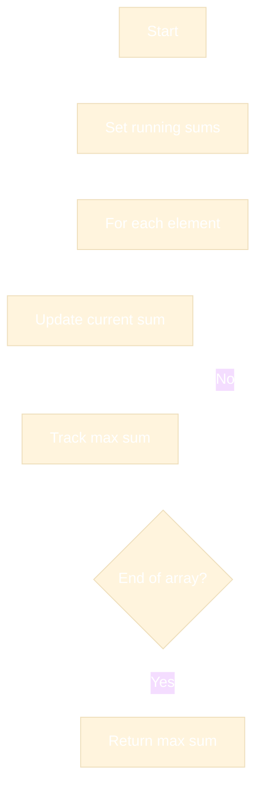

---

## 14. Dutch National Flag Algorithm

### Explanation
This algorithm partitions an array into three groups:

- values less than pivot
- values equal to pivot
- values greater than pivot

It is used for sorting arrays with three distinct groups efficiently.

### Algorithm
Use three pointers:

- `low`
- `mid`
- `high`

Swap items depending on value versus pivot.

### Time and Space Complexity
- Time: O(n)
- Space: O(1)

### Flow Diagram
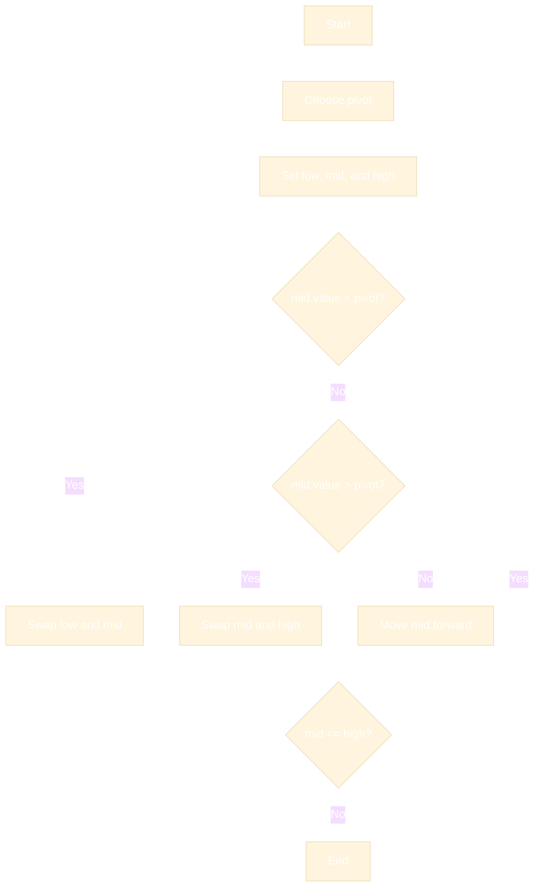

---

## 15. Boyer-Moore Majority Vote

### Explanation
This algorithm finds the majority element in an array in linear time.

A majority element appears more than `n / 2` times.

### Algorithm
Use a candidate and a counter:

- If count is 0, set candidate to current element
- If current element matches candidate, increment count
- Otherwise decrement count

After this pass, verify candidate by counting occurrences.

### Time and Space Complexity
- Time: O(n)
- Space: O(1)

### Flow Diagram
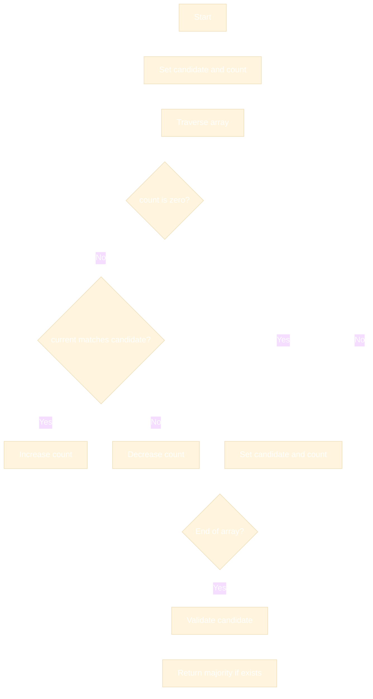

---

## 16. Merge Intervals

### Explanation
Merge intervals combines overlapping ranges into a single range.

This helps solve scheduling and overlap problems.

### Algorithm
1. Sort intervals by start time
2. Push first interval into result
3. For each next interval:
   - if overlap, merge them
   - else push separately

### Time and Space Complexity
- Time: O(n log n) because of sorting
- Space: O(n) for output

### Flow Diagram
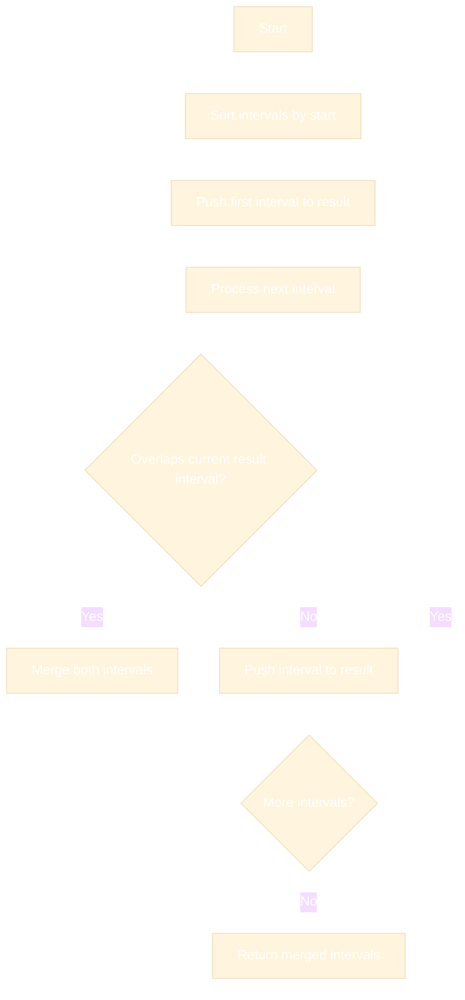

---

## 17. Array Partitioning

### Explanation
Array partitioning rearranges elements around a pivot or criterion, often to separate smaller and larger values.

This is used in:

- Quick sort partitioning
- Reordering data
- Selection and ranking problems

### Algorithms
- Hoare partitioning
- Lomuto partitioning
- Three-way partitioning (Dutch National Flag)

### Time and Space Complexity
- Time: O(n)
- Space: O(1) in-place partitioning

### Flow Diagram
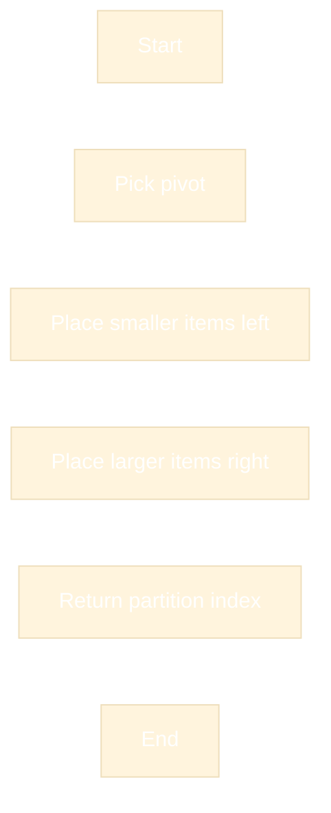

---

## Summary of Core Patterns

The array techniques above are the foundation for many DSA problems:

- Reverse / Rotate → pointer manipulation
- Merge / Partition → combining and arranging data
- Frequency counting → key-value lookup
- Prefix / Suffix / Difference → range queries and updates
- Subarray techniques → best segments and optimization
- Matrix traversal → 2D array processing
- Kadane / Majority Vote / Dutch Flag → advanced optimal array problem solving

### Complexity Cheat Sheet

| Technique | Time | Space |
|---|---:|---:|
| Reverse array | O(n) | O(1) |
| Rotate array | O(n) | O(1) or O(n) |
| Merge arrays | O(n + m) | O(n + m) |
| Frequency counting | O(n) | O(k) |
| Prefix sums | O(n) | O(n) |
| Suffix sums | O(n) | O(n) |
| Difference array | O(n + q) | O(n) |
| Subarray brute force | O(n²) | O(1) |
| Kadane | O(n) | O(1) |
| Spiral traversal | O(rows × cols) | O(1) |
| Diagonal traversal | O(rows × cols) | O(1) |
| Merge intervals | O(n log n) | O(n) |

---

## Final Advice

To master these techniques:

1. Learn the concept deeply.
2. Understand when it is useful.
3. Implement it manually in TypeScript.
4. Practice 2–3 easy and 3–5 medium problems per technique.
5. Focus on identifying the pattern before writing code.

This is the key skill in DSA: not just knowing a technique, but recognizing the right moment to apply it.
