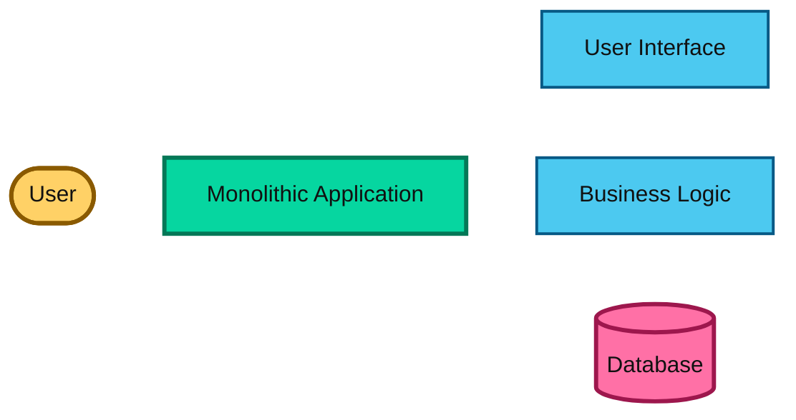
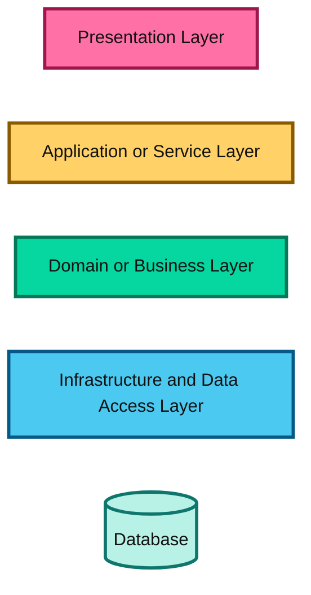
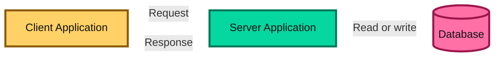
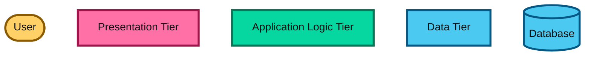
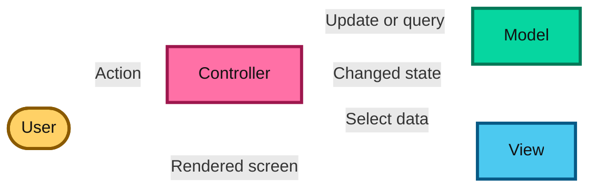
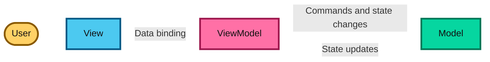
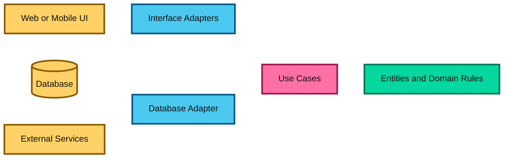
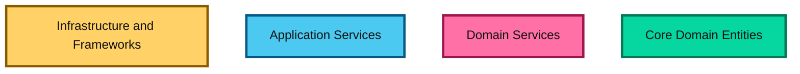
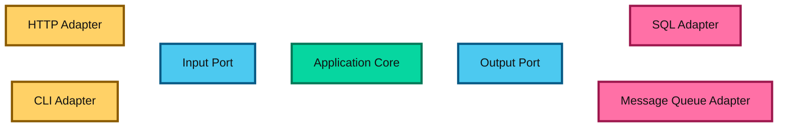
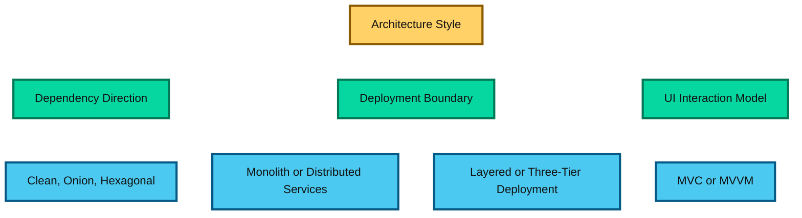

# Architecture Types

This guide explains the main application architecture styles in the System Design roadmap. The diagrams use bright colors to make boundaries, responsibilities, and request flow easy to distinguish.

## 1. Monolithic Architecture

### Concept

A monolithic architecture is a single application in which the user interface, business logic, and data access code are all part of one deployable unit. The application may still contain multiple internal modules, packages, or services, but they are not isolated as separate running systems. A team usually deploys the whole system together as one binary, container, or service.

This architecture is common in early-stage products because it is easy to understand, quick to build, and simple to operate. All requests flow through one application process, which makes debugging a direct process and reduces network overhead. It works well when the system is small enough that a single team can manage the full codebase and the release process does not need to be highly modular.

The main weakness is coupling. If one part of the application becomes unstable or slow, it can affect the entire system. Scaling also becomes less flexible because the full application must be scaled even when only one module experiences load. For that reason, many teams move away from monoliths as their product grows and the system becomes harder to evolve safely.

### Diagram

### Explanation

The user interface, business rules, and data access code are packaged into one deployable application. A request usually stays inside the application process before reaching the database.

Monoliths are simple to develop, test, deploy, and debug, especially for a small team or an early product. The main trade-off is that the whole application must usually be scaled and deployed together. A change in one feature can also affect the release of every feature.

## 2. Layered Architecture

### Concept

Layered architecture breaks a system into horizontal responsibility groups such as presentation, business logic, and infrastructure. Each layer has a clearly defined purpose and usually depends only on the layer below it. This creates an easier-to-follow structure compared with a single large codebase where all logic is mixed together.

The idea is to separate concerns. The presentation layer handles rendering and user interaction, the application layer coordinates use cases, the business domain layer contains rules and logic, and the infrastructure layer interacts with databases or external services. This separation helps teams maintain code and assign work more cleanly.

Layered architecture is useful when the system has moderate complexity and needs a stable structure without the overhead of a full distributed design. It is common in enterprise applications and traditional web systems. The trade-off is that strict layering can become rigid over time, and if teams over-engineer the boundaries, simple features can become slower to implement and harder to change.

### Diagram

### Explanation

The presentation layer handles input and output, the service layer coordinates use cases, the domain layer contains business rules, and the infrastructure layer communicates with external systems such as databases.

This separation makes responsibilities easier to find and encourages maintainable code. The trade-off is that a change can pass through several layers, and strict layer-by-layer dependencies can create boilerplate or make simple features feel indirect.

## 3. Client-Server Architecture

### Concept

Client-server architecture divides the system into two main roles: clients and servers. Clients are the components that request information or trigger actions, while servers are the components that provide shared data, business logic, or computational services. The client does not usually own the authoritative data or all business rules; the server does.

This pattern is foundational in most distributed systems. A browser, mobile app, desktop app, or external service can act as a client, while an API server, application service, or backend system acts as the server. The server receives requests, validates them, performs work, and returns a result. This allows many clients to use the same centralized service without duplicating logic.

It is powerful because it centralizes shared functionality and makes data access and business logic reusable across many devices and channels. At the same time, it introduces network dependency, latency, and the need for authentication, authorization, and availability guarantees. In system design, this is the starting point for many more advanced architectures.

### Diagram

### Explanation

The client is responsible for presenting information and initiating operations. The server owns shared data, business processing, authentication, or other services. Communication commonly uses HTTP, HTTPS, WebSocket, or gRPC.

This model centralizes shared capabilities and allows many clients to use the same server. It also introduces network latency, server availability concerns, and the need to secure and scale the communication boundary.

## 4. Three-Tier Architecture

### Concept

Three-tier architecture is a specific and common form of client-server design that separates the application into three responsibilities: presentation, business logic, and data storage. The presentation tier handles the interface; the application tier runs business logic and workflow validation; and the data tier stores and retrieves persistent information.

This design is used heavily in enterprise and web systems because it creates clear deployment boundaries. The web frontend or API endpoint may live in the presentation tier, the application server in the middle tier, and the database or storage in the data tier. Each tier can often be optimized, monitored, and scaled separately based on its actual workload.

The benefit is modularity. Different teams can own different tiers, and each tier can use the most suitable technology. The downside is that the application becomes more distributed than a monolith, so cross-tier communication, performance, and failure handling become more important. It is often the first step from a single application into a more scalable architecture.

### Diagram

### Explanation

The presentation tier displays screens or exposes an interface. The application tier validates requests and applies business rules. The data tier stores and retrieves information.

The tiers can often be deployed and scaled separately, which makes this pattern useful for web applications and enterprise systems. Three-tier architecture is a deployment and responsibility view; it may be implemented using layered code inside each tier.

## 5. Model-View-Controller (MVC)

### Concept

MVC is a UI architecture pattern that separates how data is modeled from how it is shown to the user and how user input is handled. The Model represents the application data and business rules, the View renders the interface, and the Controller receives input, updates the model, and decides which view to show next.

The purpose of MVC is to reduce the coupling between the user interface and the underlying business logic. A user action triggers a controller method, which may read from or update the model, then the view is refreshed with the new state. This makes the interface more structured and easier to maintain than embedding logic directly in UI code.

MVC is widely used in web frameworks and desktop UI systems, especially when the user experience is rich and interactive. It improves organization and testability, but if the controller grows too big or takes on too much business logic, the pattern can devolve into a tightly coupled code path that is harder to scale or reason about.

### Diagram

### Explanation

A user action reaches the controller. The controller asks the model to read or change application state, then selects or updates the view. The view presents the result to the user.

MVC reduces the amount of business logic placed directly in UI code and supports multiple views over the same model. In real frameworks, the exact flow differs, and poorly separated controllers can become large and difficult to maintain.

## 6. Model-View-ViewModel (MVVM)

### Concept

MVVM is a UI design pattern that focuses on separating the visual layer from the state and logic needed to present data. The View is responsible for displaying the screen, the Model holds the underlying data and business state, and the ViewModel acts as a mediator that prepares data for display and exposes commands for user actions.

This pattern is especially useful in modern reactive interfaces, where the UI should react to changing data automatically. The ViewModel transforms raw model data into a shape the view can bind to and exposes observable properties or commands, reducing manual event handling. The view binds to the ViewModel instead of directly manipulating the model.

MVVM is common in desktop, web, and mobile frameworks because it improves testability and simplifies UI behavior. It is especially good when the interface is data-driven and needs to stay in sync with state changes. The challenge is that ViewModels can become large if they absorb domain logic that belongs in a proper business layer.

### Diagram

### Explanation

The ViewModel transforms model data into a form the View can display and exposes commands that the View can invoke. Data binding keeps the View and ViewModel synchronized, reducing manual UI event wiring.

MVVM is common in desktop, mobile, and modern frontend applications. It improves testability of presentation behavior, but a ViewModel can become too large if it absorbs domain logic that belongs in the model or a separate service.

## 7. Clean Architecture

### Concept

Clean Architecture is a software design approach that puts business rules and application use cases at the center, while leaving frameworks, databases, and external services at the edges. The central idea is that the domain and business logic must not depend on infrastructure details such as specific databases, web frameworks, or third-party APIs.

In this model, the inner layer contains enterprise rules and use cases, while the outer layers handle input adapters, UI concerns, database access, and external integrations. Dependencies are directed inward, which means infrastructure depends on the domain, not the other way around. This makes the system easier to test and less fragile when tools or technologies change.

Clean Architecture is useful when business logic is valuable, stable, and should remain independent from implementation details. It gives long-term flexibility and better separation of concerns, but it also requires discipline and may add abstraction layers that feel heavy for small applications.

### Diagram

### Explanation

Entities contain core business rules that should not depend on frameworks or databases. Use cases coordinate application behavior. Interface adapters translate between external formats and internal models, while infrastructure implements details such as persistence and external integrations.

The dependency rule points toward the center. This keeps business logic testable and replaceable, but it requires interfaces, mapping code, and disciplined dependency management.

## 8. Onion Architecture

### Concept

Onion Architecture organizes an application as concentric layers, with the domain at the center and infrastructure on the outside. The inner layers define core business logic, while the outer layers contain services, application orchestration, and technical implementations such as repositories, databases, and external integrations.

The idea is similar to Clean Architecture: the most important business rules should not depend on frameworks or storage. The domain model sits at the core, domain services handle business behavior, and application services coordinate use cases. Outer layers can depend on the inner ones, but inner layers remain unaware of technical details.

This pattern is especially effective when the system has a strong domain model and when maintainability and long-term flexibility matter more than low ceremony. It creates a very clear dependency direction, but it also requires careful separation of responsibilities to avoid mixing business logic with infrastructure code.

### Diagram

### Explanation

The core entities represent the most stable business concepts. Domain services express domain behavior that does not naturally belong to one entity. Application services coordinate use cases, and infrastructure provides technical implementations such as repositories and messaging.

The inner layers do not know about the outer layers. This supports replacing a database, UI framework, or transport mechanism with limited impact on business rules. The trade-off is additional abstractions and a need to distinguish domain logic from application orchestration.

## 9. Hexagonal Architecture (Ports and Adapters)

### Concept

Hexagonal Architecture, also called Ports and Adapters, keeps the application core isolated from external systems by exposing a set of ports. A port defines what the application needs from the outside world, while an adapter implements that interaction using a specific technology such as HTTP, a database, a message queue, or a CLI interface.

This means the core business logic can remain stable even if the system changes from REST API calls to a queue-driven event bus or from SQL to NoSQL. Input adapters convert external interactions into calls to the application, and output adapters convert the application’s needs into database or service calls.

The pattern is valuable when a system must integrate with many different technologies or when the core business rules must stay portable and testable. Its main cost is additional abstraction and mapping code at the boundaries, but that investment pays off when teams need to swap or evolve interfaces without destabilizing the domain logic.

### Diagram

### Explanation

Input adapters translate external requests into calls to input ports. The application core executes business use cases without knowing whether the request came from HTTP, a command line tool, or a message consumer. Output ports define what the core needs from external systems, and output adapters implement those contracts.

This design makes the core easy to test and allows infrastructure to be swapped. Its main cost is the extra interfaces and translation code needed at the boundaries.

## How These Architectures Relate

The patterns describe different concerns and can be combined:

A single system may be a monolith deployed as a three-tier application, organized internally with layered architecture, and use MVC or MVVM for its frontend. Clean, Onion, and Hexagonal Architecture are closely related approaches for controlling dependencies around business logic.

## Quick Selection Guide

| Architecture | Best fit | Main strength | Main trade-off |
| --- | --- | --- | --- |
| Monolithic | Small to medium applications | Simple deployment | Features scale and release together |
| Layered | Business applications | Clear responsibilities | Can introduce rigid call chains |
| Client-Server | Shared services and data | Centralized processing | Network and server dependency |
| Three-Tier | Web and enterprise applications | Separately managed tiers | More deployment boundaries |
| MVC | UI applications | Separates input, state, and view | Controllers can grow too large |
| MVVM | Data-bound UI applications | Testable presentation logic | ViewModels can become bloated |
| Clean | Systems with long-lived business rules | Framework-independent domain | More abstractions and mapping |
| Onion | Domain-focused applications | Strong inward dependency flow | Requires architectural discipline |
| Hexagonal | Systems with many integrations | Replaceable adapters | Port and adapter overhead |
