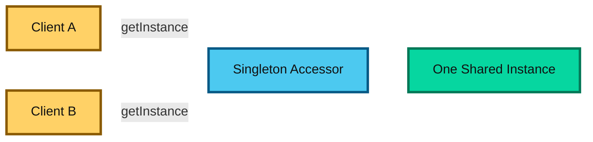
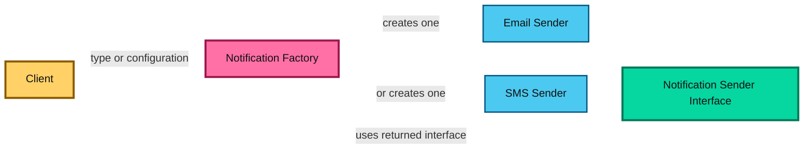
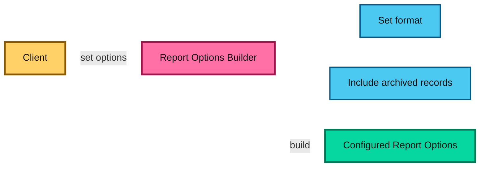
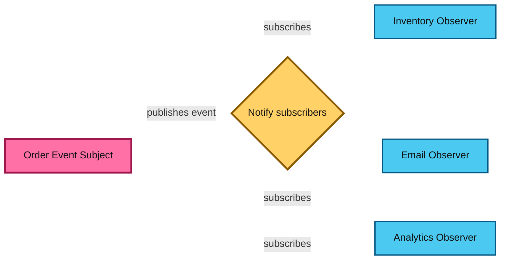
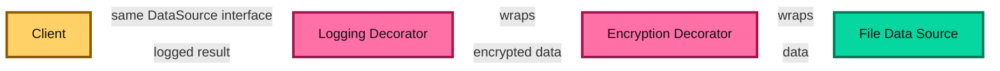
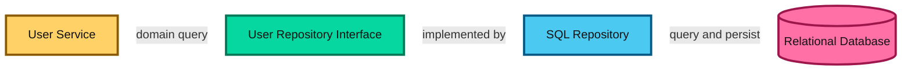
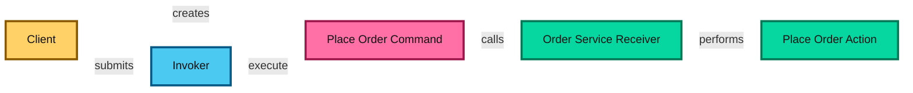
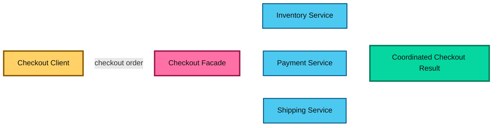
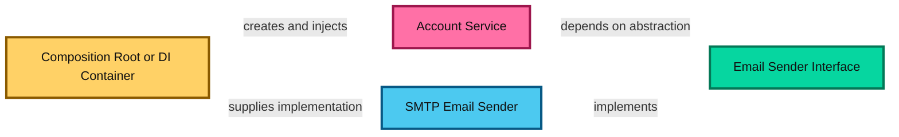

```mermaid
flowchart LR
  linkStyle default stroke:#FFFFFF,stroke-width:3px;
  C[Application Client] -->|expected charge interface| T[Payment Gateway Target]
  T --> A[Legacy Payment Adapter]
  A -->|converts cents to dollars| L[Legacy Processor]

  classDef client fill:#FFD166,stroke:#8A5A00,stroke-width:3px,color:#111;
  classDef target fill:#06D6A0,stroke:#047857,stroke-width:3px,color:#111;
  classDef adapter fill:#FF70A6,stroke:#9D174D,stroke-width:3px,color:#111;
  classDef legacy fill:#4CC9F0,stroke:#075985,stroke-width:3px,color:#111;
  class C client;
  class T target;
  class A adapter;
  class L legacy;
```

# Software Design Patterns

This guide explains commonly used design patterns for organizing object-oriented and application code. Each pattern is a reusable approach to a recurring design problem, not a rule that every codebase must follow. The examples use TypeScript-style syntax and focus on the intent behind each pattern.

## Why Design Patterns Matter

Patterns give developers a shared vocabulary for discussing structure and behavior. Used appropriately, they can reduce coupling, clarify responsibilities, and make a design easier to extend. Used automatically, they can add indirection and make simple code harder to follow.

A useful pattern should make the design clearer than the straightforward alternative.


---

## 1. Singleton

### Concept

Singleton ensures that a type has a single shared instance for the lifetime of a process or application domain, and it exposes that instance through a controlled access point. The pattern is used when a component represents a single system-wide resource or policy, such as configuration, logging, thread pools, or a registry.

The underlying goal is to avoid creating multiple competing copies of something that should logically be unique. For example, if two configuration objects exist in memory and start diverging, the application may behave inconsistently because different parts of the system are reading different settings. Singleton helps restrict that to one canonical object.

At a conceptual level, the pattern enforces uniqueness by controlling construction. The constructor is hidden or restricted, and a static accessor decides whether to create the instance or return the existing one. This gives the application one point of truth for that resource.

### Diagram



### Why it matters

In real systems, some objects are naturally global or process-scoped. A database connection manager, centralized configuration manager, or application-level event bus may need to be shared across the system. Singleton makes that intent explicit and prevents duplicate instances from silently breaking coordination.

### Example

```ts
class AppConfig {
  private static instance: AppConfig;

  private constructor() {}

  static getInstance(): AppConfig {
    if (!AppConfig.instance) {
      AppConfig.instance = new AppConfig();
    }
    return AppConfig.instance;
  }
}

const config = AppConfig.getInstance();
```

### When to use it

Use it only when one instance is a real domain or process requirement, such as a carefully managed in-process registry. Many frameworks provide safer lifecycle or dependency-injection mechanisms for shared services.

It is especially relevant when state must be centralized, not duplicated. For example, an application-wide API configuration object should be one consistent source of configuration, not instances scattered across modules. However, the pattern should be applied sparingly because it creates a hidden global dependency.

### Trade-offs

A singleton introduces global access and hidden dependencies. It can make tests order-dependent, complicate parallel execution, and become a bottleneck if it owns mutable state. If multiple threads mutate the singleton, the system can develop race conditions unless the state is carefully synchronized. It is also process-local: a single instance in one process does not mean one instance across multiple application servers or a distributed system.

### Best practice

Use Singleton for truly unique resources, not for convenience. If a shared dependency can be injected instead, dependency injection is often cleaner and more testable. In modern architecture, a single runtime object managed by a container or a well-defined application context is often a better choice than writing a custom singleton for every shared service.

---

## 2. Factory

### Concept

A factory centralizes object creation and hides the choice of concrete implementation from the calling code. Instead of the caller deciding which concrete class to instantiate, the caller asks the factory for the appropriate object based on the required behavior or input.

This is particularly valuable when constructing an object involves more than simply calling a constructor. For example, the code may need to choose among different implementations, configure dependencies, validate input, or create a complex object graph. A factory keeps that logic in one place and reduces duplication across the application.

The factory pattern is a good fit when the system knows several implementations of a common interface but the calling code should not depend on which one is chosen. That makes the design more flexible when new implementations are added later.

### Diagram



### Example

```ts
interface NotificationSender {
  send(message: string): void;
}

class EmailSender implements NotificationSender {
  send(message: string) { /* send email */ }
}

class SmsSender implements NotificationSender {
  send(message: string) { /* send SMS */ }
}

function createSender(channel: 'email' | 'sms'): NotificationSender {
  if (channel === 'email') return new EmailSender();
  return new SmsSender();
}
```

### When to use it

Use a factory when creation involves selection, setup, validation, or other logic that callers should not need to know about. It is especially helpful when you have a family of related objects that share a common interface but differ in implementation details. The factory becomes the place that decides which variant is correct.

This pattern is commonly used in payment systems, notification systems, database driver creation, and engine selection where client code should only say what it needs, not how to instantiate it.

### Trade-offs

Factories add a level of indirection. A simple constructor call does not need a factory unless the creation logic or concrete type is likely to vary. If the number of object types is tiny and selection is trivial, a direct constructor or parameterized factory function may be clearer than a full factory hierarchy.

### Why it matters in design

A factory helps decouple client code from concrete classes. The client depends on the abstraction, not the implementation. This is one of the main strengths of clean object-oriented design and is often paired with interface-based design. It reduces the risk of scattered conditional logic throughout an application and makes adding a new implementation much safer.

---

## 3. Builder

### Concept

Builder constructs a complex object step by step, especially when the object has many optional settings or must be validated before use. It separates the logic of building from the logic of representing the final object.

This pattern is useful when an object has many configuration parameters, many of which are optional, or where some combinations are invalid. A constructor with ten parameters is difficult to read and error-prone. A builder allows the code to call methods like `.setFormat()`, `.enableCompression()`, or `.setRetryPolicy()`, making the object creation process explicit and readable.

A builder is often used when the final object must be created in stages and the steps are meaningful. Instead of forcing a single constructor to handle everything, the builder collects configuration through fluent calls and then assembles the final result when ready.

### Diagram



### Example

```ts
class ReportOptionsBuilder {
  private format: 'csv' | 'pdf' = 'csv';
  private includeArchived = false;

  setFormat(format: 'csv' | 'pdf'): this {
    this.format = format;
    return this;
  }

  includeArchivedRecords(): this {
    this.includeArchived = true;
    return this;
  }

  build() {
    return {
      format: this.format,
      includeArchived: this.includeArchived
    };
  }
}

const options = new ReportOptionsBuilder()
  .setFormat('pdf')
  .includeArchivedRecords()
  .build();
```

### When to use it

Use it when a constructor would have many parameters, especially optional or similarly typed parameters, or when construction has meaningful steps and validation. It is very common in configuration-heavy systems, complex requests, UI component setup, and API client configuration where some values are optional and others are constrained by combinations.

### Trade-offs

A builder creates extra code and may be unnecessary for small objects. Prefer clear object literals or parameter objects when those already make construction understandable. Also, if the object is simple and immutable, the extra builder code may be overkill. The builder should solve an actual readability or validation problem, not create complexity for its own sake.

### Why it matters in design

The builder pattern improves readability and reduces the chance of invalid object states. Instead of asking callers to remember a long sequence of positional arguments, it gives them named, sequential configuration steps. This makes construction more maintainable and easier to validate. It is especially important when the object can be created in multiple legal ways but should still enforce internal consistency.

---

## 4. Observer

### Concept

Observer defines a one-to-many relationship: when a subject changes state or emits an event, its registered observers are notified. This allows multiple components to react to the same event without being tightly coupled to each other.

The subject is the source of truth; it knows about its observers and publishes updates. The observers are interested consumers that react when the event occurs. This design is especially useful when one change should trigger multiple interpretations or actions.

This pattern is not just about UI updates. It is a general model for event-driven systems where a component emits state change notifications and other parts of the system decide whether to react, log, transform, or re-render. The observer pattern decouples the publisher from the subscribers and makes the system more extensible.

### Diagram



### Example

```ts
interface Observer<T> {
  update(event: T): void;
}

class OrderEvents {
  private observers: Observer<string>[] = [];

  subscribe(observer: Observer<string>) {
    this.observers.push(observer);
  }

  publish(event: string) {
    for (const observer of this.observers) {
      observer.update(event);
    }
  }
}
```

### When to use it

Use it when multiple independent components need to react to an event without the publisher depending directly on each component. UI event systems, analytics pipelines, and in-process domain events are common examples. The observer pattern is especially useful when you want to decouple a state change from the code that handles the consequences.

### Trade-offs

Observers can make control flow less obvious because the logic is spread across multiple subscriber functions. If any subscriber fails, it may affect the overall event flow unless the system handles exceptions carefully. The pattern also needs lifecycle management: subscribers may need to unregister to prevent memory leaks or duplicate notifications. In-process Observer is not the same as a distributed message broker; it does not provide persistence or cross-process delivery by itself.

### Why it matters in design

The observer pattern reduces tight coupling between the producer and consumer. The publisher only needs to know that something wants to listen, not exactly which listeners or how they behave. In large systems, this flexibility is valuable because it allows components to be added or removed without rewriting the source component. However, the pattern should be used consciously, because event-driven flows can become difficult to debug when many subscribers are involved.

---

## 5. Strategy

### Concept

Strategy defines a family of interchangeable algorithms behind a common interface. The caller can select a strategy without embedding every algorithm in one large conditional. Instead of writing a long if/else or switch statement, the code delegates behavior to a pluggable strategy object.

This pattern is about selecting the behavior you want at runtime. The surrounding code remains stable, while the actual decision-making logic changes based on the selected strategy. It is a strong fit when the same task can be performed in multiple valid ways, depending on business context, user preferences, or environment.

### Diagram


### Example

```ts
interface ShippingCostStrategy {
  calculate(weightKg: number): number;
}

class StandardShipping implements ShippingCostStrategy {
  calculate(weightKg: number) { return weightKg * 2; }
}

class ExpressShipping implements ShippingCostStrategy {
  calculate(weightKg: number) { return weightKg * 5; }
}

function quoteShipping(
  weightKg: number,
  strategy: ShippingCostStrategy
): number {
  return strategy.calculate(weightKg);
}
```

### When to use it

Use it when the same task has multiple policies or algorithms that vary by context, configuration, or user choice. A good example is shipping cost calculation, where standard, express, and priority shipping each implement the same contract but apply different pricing rules. Another example is authentication policies, where different strategies check tokens differently depending on the client or environment.

### Trade-offs

Each strategy adds a type or object to understand. If there are only one or two trivial cases that never change, a simple conditional may be clearer. Also, an overload of strategies can become hard to navigate if they are too numerous or their behavior is not well documented.

### Why it matters in design

The strategy pattern supports open/closed behavior: the surrounding code stays stable while new strategies can be added without changing the existing logic. This makes it easier to support feature-specific policies, different algorithms for different regions, or compliance-based decision logic. It also keeps each algorithm isolated and testable, which improves maintainability.

---

## 6. Decorator

### Concept

Decorator adds behavior to an object by wrapping it while preserving the same interface. Instead of creating a larger subclass hierarchy for every possible variant, the code can compose several wrappers around a base object.

This pattern is especially useful when object behavior is optional and can be layered. For example, a base database connection can be wrapped with logging, caching, encryption, or metrics instrumentation. Each wrapper adds or modifies behavior without changing the original component. The client still interacts with the same interface, but the runtime behavior becomes richer.

This is different from inheritance because it adds functionality at composition time rather than by creating many specialized subclasses. It supports flexible combinations such as "compressed + encrypted + logged data source" without creating a class explosion.

### Diagram



### Example

```ts
interface DataSource {
  read(): string;
}

class FileDataSource implements DataSource {
  read() { return 'file contents'; }
}

class EncryptedDataSource implements DataSource {
  constructor(private source: DataSource) {}

  read() {
    return decrypt(this.source.read());
  }
}

function decrypt(value: string): string {
  return value; // illustrative placeholder
}
```

### When to use it

Use it when optional responsibilities such as logging, compression, encryption, or buffering should be combined around an object without creating a subclass for every combination. It is common in middleware layers, stream processing, and service wrappers where one component needs additional responsibilities without changing its root behavior.

### Trade-offs

Many wrappers can make runtime behavior and debugging harder to trace. The order of wrapping matters, and the final object may behave differently depending on the stacking sequence. This pattern should be used carefully when the runtime composition becomes hard to reason about. It also should not be confused with language-level decorators, which are syntax features in some languages.

### Why it matters in design

Decorator is highly useful when responsibilities are dynamic and independent. Instead of creating a rigid inheritance tree, you can attach features as needed. This reduces the number of classes and lets the system adapt to combinations of behaviors without creating a combinatorial explosion. In system design, this often appears in cross-cutting concerns such as tracing, auth headers, caching, and instrumentation.

---

## 7. Adapter

### Concept

Adapter translates one interface into another interface expected by a client. It allows incompatible components to work together without changing either component's core implementation. The adapter sits at the boundary between systems that speak different contracts.

The adapter is useful when integrating third-party libraries, legacy code, or external services whose API is not aligned with your application model. Instead of refactoring all of that code to match your system, the adapter converts calls from the required format into the format the external component already understands. This keeps the rest of the system decoupled from vendor-specific or legacy-specific details.

### Diagram



### Example

```ts
interface PaymentGateway {
  charge(amountCents: number): Promise<void>;
}

class LegacyProcessor {
  makePayment(amount: number) { /* amount is in dollars */ }
}

class LegacyPaymentAdapter implements PaymentGateway {
  constructor(private processor: LegacyProcessor) {}

  async charge(amountCents: number) {
    this.processor.makePayment(amountCents / 100);
  }
}
```

### When to use it

Use it when integrating a legacy API, third-party SDK, or external service whose interface does not match the one your application needs. It is common in cases like a legacy payment processor, an external CRM API, or a database abstraction layer where the application code expects a cleaner interface than the underlying dependency offers.

### Trade-offs

An adapter should translate the boundary, not conceal important differences such as units, error semantics, or retry behavior. If the underlying system has significant conceptual gaps, the adapter may need to enforce policy rather than merely reinterpret calls. Too many adapter layers can obscure the actual flow of the application and make debugging more difficult.

### Why it matters in design

The adapter pattern is a boundary-protection tool. It prevents the rest of the system from depending on external API quirks, naming differences, or legacy structures. This reduces the impact of vendor changes and helps the domain logic remain clean and stable. In practice, adapters are often introduced around data stores, network clients, and system integrations where compatibility issues are common.

---

## 8. Repository

### Concept

Repository provides a collection-like interface for retrieving and persisting domain objects while hiding the details of the underlying data store. The domain or application code asks for a user, order, or product by some concept, and the repository decides how to fetch or store it.

This pattern is especially useful when the persistence technology changes or when the application has more meaningful query behavior than a simple CRUD layer. The repository protects the rest of the codebase from low-level details such as SQL, ORM config, document collections, or storage-specific query syntax.

Think of it as a domain vocabulary for data access: instead of controllers or services knowing how to query a database directly, they talk to a repository that expresses a business concept such as "find a user by ID" or "save a payment record." This makes the code easier to reason about and keeps persistence details in one place.

### Diagram



### Example

```ts
interface UserRepository {
  findById(id: string): Promise<User | null>;
  save(user: User): Promise<void>;
}

class UserService {
  constructor(private users: UserRepository) {}

  async getUser(id: string) {
    return this.users.findById(id);
  }
}
```

### When to use it

Use it when it creates a useful boundary between domain or application logic and persistence, or when the application has meaningful query and persistence behavior to centralize. It is particularly effective when the application has domain services that should not know about SQL, database drivers, or storage implementation details.

### Trade-offs

A generic repository that merely repeats every ORM method can add little value and hide useful database capabilities. If the repository becomes an unstructured abstraction over everything, it may become a leaky and confusing layer. Keep queries explicit when they are specific to the application's access patterns, and maintain a clean separation between domain behavior and persistence logic.

### Why it matters in design

The repository pattern creates a stable data-access boundary and helps separate business logic from infrastructure. This is especially useful in layered or domain-driven designs, where services should express intent rather than know how data is stored. Good repositories improve testability because they can be mocked or implemented in memory for unit tests. They also make it easier to evolve the persistence layer without refactoring the core domain logic.

---

## 9. Command

### Concept

Command represents a request or operation as an object. The sender can issue a command without knowing how the receiver performs it. This pattern turns an action into a first-class object that can be stored, queued, logged, retried, or invoked later.

The key idea is that commands capture intent. Instead of the caller directly invoking a method on a service, the caller creates a command object that knows which receiver to talk to and what to do. This separation makes the interaction more flexible and makes it easier to manage workflows that need auditing, delays, or undo support.

Commands are especially useful in UI action handling, task queues, workflow engines, and systems with asynchronous execution. They allow the operation to be treated as data and can support features such as scheduling, retry logic, transaction boundaries, and command history.

### Diagram



### Example

```ts
interface Command {
  execute(): Promise<void>;
}

class PlaceOrderCommand implements Command {
  constructor(private orderService: OrderService) {}

  async execute() {
    await this.orderService.placeOrder();
  }
}
```

### When to use it

Use it when operations need to be queued, logged, retried, scheduled, authorized, or undone, or when senders and receivers should be decoupled. It is especially valuable in business process workflows, application services, and systems where actions should be grouped into explicit user or system commands.

### Trade-offs

Command objects add structure and can be excessive for direct method calls. A command object alone does not make an operation durable, exactly-once, or safe to retry; those guarantees require additional system design. If command objects are overused, they can become a complex abstraction layer without adding real value.

### Why it matters in design

The command pattern separates the who from the what. The caller expresses an intent; the system decides when and how to execute it. This helps create cleaner workflows and better lifecycle management. It also supports undo/redo, operation auditing, and asynchronous processing patterns, which are common in interactive and transactional applications.

---

## 10. Facade

### Concept

Facade provides a simpler interface over a subsystem that has several components or complex interactions. It hides the internal complexity of a subsystem and exposes a smaller, easier-to-use API.

This is not a general abstraction for every dependency; it is specifically about reducing the cognitive load for the consumer. A subsystem might involve multiple services, object graphs, database operations, validation steps, and third-party calls. A facade consolidates that complexity into one interface and makes the caller interact with the overall capability instead of the internal assembly.

In many systems, facades appear in service layers where controllers or consumers should not be forced to know how inventory, payment, and delivery are coordinated. The facade turns multiple steps into one meaningful operation such as `checkout()` or `createUserAndProfile()`.

### Diagram



### Example

```ts
class CheckoutFacade {
  constructor(
    private inventory: InventoryService,
    private payments: PaymentService,
    private shipping: ShippingService
  ) {}

  async checkout(order: Order) {
    await this.inventory.reserve(order);
    await this.payments.charge(order);
    return this.shipping.createShipment(order);
  }
}
```

### When to use it

Use it to give a client a focused entry point to a complicated subsystem or to keep subsystem coordination out of controllers and UI code. Facades are useful when a client needs a high-level operation but should not know the internal orchestration details. They are common in e-commerce flows, account creation workflows, onboarding processes, and complex API service layers.

### Trade-offs

A facade should simplify access, not become a second subsystem that owns unrelated business logic. Keep its responsibilities cohesive and make failure handling explicit when it coordinates multiple operations. If the facade grows too large or starts doing domain logic that belongs elsewhere, it can become a vague "god object" that undermines separation of concerns.

### Why it matters in design

Facades reduce complexity for callers and provide a stable boundary around a subsystem. They help keep upper layers clean and easier to understand. In system design, this is important because it prevents controllers, handlers, or frontends from becoming orchestration code for every back-end dependency. The façade is often the right place to manage transaction boundaries, error handling, and service coordination.

---

## 11. Dependency Injection (DI)

### Concept

Dependency Injection supplies an object with the collaborators it needs instead of having it construct those collaborators itself. Constructor injection is a common form, where dependencies are passed into the object at creation time rather than directly instantiated inside the class.

This pattern is possible because the consuming object depends on abstractions rather than concrete implementations. The actual dependency can be swapped with another implementation without changing the consumer. DI creates an explicit dependency boundary and makes code easier to test, extend, and reason about.

Dependency injection is often discussed alongside the Dependency Inversion Principle (DIP), but they are not exactly the same thing. The inversion principle is the philosophical rule that high-level modules should depend on abstractions, while dependency injection is one practical way to satisfy that principle. DI is a technique for supplying dependencies; DIP is the design guideline behind the structure.

### Diagram



### Example

```ts
interface EmailSender {
  send(to: string, message: string): Promise<void>;
}

class AccountService {
  constructor(private emailSender: EmailSender) {}

  async welcome(email: string) {
    await this.emailSender.send(email, 'Welcome');
  }
}

const service = new AccountService(new SmtpEmailSender());
```

### When to use it

Use it when a component depends on collaborators that should be replaceable, independently configured, or easy to provide in tests. A DI container can manage larger object graphs and lifetimes. In real applications, it is especially useful for database access, email services, event publishers, cache clients, and external service integrations.

### Trade-offs

DI improves explicitness and testability, but excessive interfaces, global service locators, or a container for a tiny application can add indirection. The pattern should not be used as a hidden excuse to create too many abstractions. For required dependencies, constructor injection is usually the clearest and safest option. For optional or environment-specific components, factories or configuration objects may be more appropriate.

### Why it matters in design

DI reduces coupling and makes classes easier to test. If a service needs an email sender, it should receive one through its constructor instead of instantiating an SMTP client itself. This allows the application to supply a fake email sender in tests or swap implementations in production without rewriting the service logic. It also makes dependencies visible in the component signature, which improves readability and maintainability.

---

## 12. Choosing a Pattern

| Need | Pattern to consider |
| --- | --- |
| Control complex or variable object creation | Factory or Builder |
| Share exactly one in-process instance | Singleton, used cautiously |
| Notify independent components of events | Observer |
| Swap a policy or algorithm | Strategy |
| Add composable behavior around an object | Decorator |
| Integrate an incompatible interface | Adapter |
| Isolate persistence behind a domain-facing boundary | Repository |
| Represent an operation for queuing or tracking | Command |
| Offer a simple entry point to a subsystem | Facade |
| Supply dependencies from outside a component | Dependency Injection |

## 13. How Patterns Work with Design Principles

- SOLID helps define responsibilities and stable boundaries for patterns.
- DRY can motivate reuse, but a pattern should not be introduced just to remove a few similar lines.
- KISS is a useful check: if the pattern obscures a simple flow, use the simpler design.
- YAGNI discourages adding pattern infrastructure for hypothetical future requirements.

Patterns and principles are tools for reasoning, not a checklist. Start from the actual change or complexity you need to manage, then choose the smallest design that addresses it.

## Final Takeaway

Design patterns provide names for common solutions, but their value depends on context. Use them when they make a responsibility, extension point, or system boundary clearer. Avoid applying them mechanically, and revisit the design as real requirements evolve.
