# Networking Concepts

This guide explains the core networking concepts that form the foundation of distributed systems, web applications, and modern cloud architecture. These terms describe how devices communicate with each other, how addresses are assigned, and how traffic is routed across networks.

## Why These Concepts Matter

Every application request eventually travels through a network. Whether it is a browser calling an API, a database connection, or a microservice interaction, the communication depends on network addresses, ports, naming, routing, and security mechanisms. Understanding these concepts helps you reason about connectivity, latency, reachability, firewall behavior, and deployment architecture.

---

## 1. IP Address

### Concept

An IP address is a unique identifier assigned to a device on a network so that it can send and receive data. It is used at the network layer to identify the source and destination of packets.

There are two major types:

- IPv4: e.g. 192.168.1.10
- IPv6: e.g. 2001:db8::1

IPv4 is still the most common in many systems, while IPv6 is increasingly important because IPv4 addresses are limited.

### Why it matters

When a device sends data, it does not send it to a person or application directly; it sends it to an IP address. Routers and network devices use IP addresses to determine where packets should go.

### Example

```text
Client: 192.168.1.25
Server: 10.0.0.12
Request: Client -> Server via IP routing
```

### Key idea

An IP address identifies a machine on the network, not necessarily a specific process or application.

### Trade-offs

- IPv4 is widely supported but limited in address space.
- IPv6 is more scalable but requires compatibility handling in mixed environments.

---

## 2. MAC Address

### Concept

A MAC address is a hardware-level identifier assigned to a network interface card (NIC). It is used within a local network segment, usually for communication inside the same LAN.

MAC addresses are typically permanent and tied to the network adapter hardware, whereas IP addresses can change based on network configuration.

### Why it matters

Routers and switches use MAC addresses to deliver data within a local area network. When a device sends data to another device in the same LAN, the frame may reach the target using its MAC address.

### Example

```text
PC NIC MAC: 00:1A:2B:3C:4D:5E
Switch stores MAC-to-port mapping
``` 

### Key idea

MAC addresses work at the local link layer. IP addresses work across networks. Together, they enable communication across both local and remote networks.

### Trade-offs

- MAC is excellent for local networking.
- It is not routable across the internet the way IP is.

---

## 3. Port

### Concept

A port is a logical endpoint used to distinguish different services running on the same IP address. Ports allow one machine to host multiple applications or processes simultaneously.

Examples:

- 80: HTTP
- 443: HTTPS
- 3306: MySQL
- 5432: PostgreSQL

### Why it matters

An IP address identifies the machine, but the port identifies which application on that machine should receive the traffic.

### Example

```text
Server IP: 10.0.0.12
Web app: 10.0.0.12:80
API service: 10.0.0.12:8080
Database: 10.0.0.12:5432
```

### Key idea

A connection is typically described as:

```text
IP:PORT
```

For example: `10.0.0.12:443`

### Trade-offs

- Ports enable multiplexing on a single server.
- Services must avoid port conflicts.
- Firewalls often control which ports are allowed.

---

## 4. Socket

### Concept

A socket is an endpoint for communication between two processes over a network. It combines an IP address and a port, and is used in protocols like TCP and UDP.

A socket is often described as:

```text
(protocol, local IP, local port, remote IP, remote port)
```

### Why it matters

Sockets represent active communication channels. They let applications send and receive data reliably or connectionlessly depending on the protocol.

### Example

```text
TCP socket: 192.168.1.5:5000 -> 13.233.4.7:443
```

### Key idea

A port alone is not enough; a socket describes the actual communication endpoint for a process.

### Trade-offs

- TCP sockets are connection-oriented and reliable.
- UDP sockets are lightweight and faster for real-time traffic, but less reliable.

---

## 5. DNS

### Concept

DNS (Domain Name System) translates human-friendly domain names like `google.com` into IP addresses that computers understand.

Example:

```text
google.com -> 142.250.183.110
```

### Why it matters

People use names, machines use numbers. DNS is the system that bridges that gap.

### Example flow

```text
Browser asks DNS: "What is the IP for api.example.com?"
DNS returns: 54.123.98.10
Browser connects to 54.123.98.10
```

### Key idea

DNS is essentially the phonebook of the internet.

### Common record types

- A: maps domain to IPv4 address
- AAAA: maps domain to IPv6 address
- CNAME: alias to another domain
- MX: mail server records
- TXT: metadata and verification

### Trade-offs

- DNS makes the internet usable for humans.
- DNS lookups add latency if not cached.
- Misconfigured DNS can make services unreachable even if servers are running.

---

## 6. DHCP

### Concept

DHCP (Dynamic Host Configuration Protocol) automatically assigns IP addresses and network settings to devices when they join a network.

It can provide:

- IP address
- Subnet mask
- Default gateway
- DNS server

### Why it matters

Without DHCP, every device on a network would need manual configuration. DHCP simplifies setup for laptops, phones, printers, and IoT devices.

### Example

```text
Device boots up
Device sends DHCP Discover
Server responds with DHCP Offer
Device requests the IP
Server confirms with DHCP Acknowledge
```

### Key idea

DHCP manages the dynamic assignment of IP configuration to clients on a LAN.

### Trade-offs

- Easier network administration
- IPs can change over time
- Devices may lose connectivity if DHCP server fails

---

## 7. NAT

### Concept

NAT (Network Address Translation) allows multiple devices on a private network to share one public IP address when communicating over the internet.

### Why it matters

There are not enough public IPv4 addresses for every device, so NAT lets private devices reuse a single public address.

### Example

```text
Private devices: 192.168.0.10, 192.168.0.11, 192.168.0.12
Public IP: 203.0.113.75
NAT maps internal requests to the shared public address
```

### Key idea

NAT hides private network addresses behind a public address.

### Types

- Static NAT: one private IP always maps to one public IP
- Dynamic NAT: a pool of public IPs is assigned dynamically
- PAT (Port Address Translation): many devices share one public IP using different ports

### Trade-offs

- Saves public IPv4 addresses
- Helps network security by hiding internal IPs
- Complicates peer-to-peer communication and certain protocols

---

## 8. VPN

### Concept

A VPN (Virtual Private Network) creates a secure encrypted tunnel between a device or network and another network over the public internet.

### Why it matters

A VPN protects data in transit and allows remote users to access private corporate networks as if they were physically connected.

### Example

```text
Remote employee laptop
     ↓
Encrypted VPN tunnel
     ↓
Private company network
```

### Key idea

VPN extends a private network over a public network while keeping traffic confidential and authenticated.

### Common use cases

- Remote work access
- Secure branch-to-branch communication
- Accessing private services over the internet
- Privacy and tunneling over public Wi-Fi

### Trade-offs

- Better security and privacy
- May add latency and complexity
- Requires proper authentication and key management

---

## Relationship Between These Concepts

These networking concepts work together as a full communication model:

```mermaid
flowchart LR
    linkStyle default stroke:#FFFFFF,stroke-width:3px;
    U[User enters domain] --> D[DNS resolves name]
    D --> IP[IP Address identifies destination]
    IP --> PORT[Port identifies service]
    PORT --> S[Socket represents connection endpoint]
    S --> N[Network path via routers and NAT]
    N --> M[MAC handles local delivery]
    M --> L[LAN / Local network]

    classDef user fill:#FFD166,stroke:#8A5A00,stroke-width:3px,color:#111;
    classDef core fill:#06D6A0,stroke:#047857,stroke-width:3px,color:#111;
    classDef route fill:#4CC9F0,stroke:#075985,stroke-width:2px,color:#111;
    classDef local fill:#FF70A6,stroke:#9D174D,stroke-width:3px,color:#111;
    class U user;
    class D,IP,PORT,S,N core;
    class M,L route;
```



### Simple communication flow

```text
User types example.com
        ↓
DNS resolves to an IP
        ↓
Router/Internet path chosen
        ↓
Traffic reaches the correct machine
        ↓
Port directs traffic to the service
        ↓
Socket handles the active connection
```

---

## Quick Comparison

| Concept | Main purpose | Scope |
| --- | --- | --- |
| IP | Identify a device on a network | Internet / network layer |
| MAC | Identify a NIC on the local network | Local LAN |
| Port | Identify a service on a device | Host level |
| Socket | Represent an active communication endpoint | Process / connection |
| DNS | Map names to IPs | Name resolution |
| DHCP | Assign network settings automatically | Local network |
| NAT | Share public IPs among private devices | Network edge |
| VPN | Securely tunnel private traffic over public networks | Secure connectivity |

---

## Final Takeaway

Networking concepts are not isolated topics—they are layers of the same communication model. IP and MAC handle addressing, DNS and DHCP simplify discovery and configuration, ports and sockets identify communication endpoints, NAT helps with public address sharing, and VPN adds security and privacy over untrusted networks.

Understanding these concepts is essential for debugging distributed systems, designing cloud architecture, securing services, and reasoning about how requests physically move from a client to a server.
