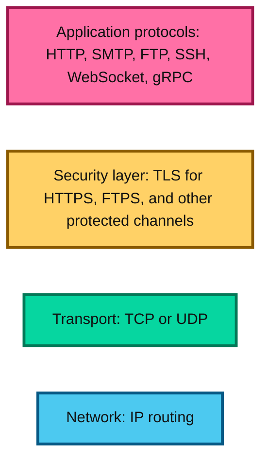
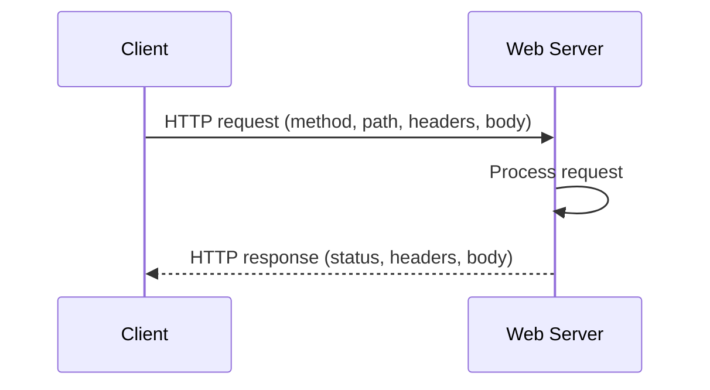
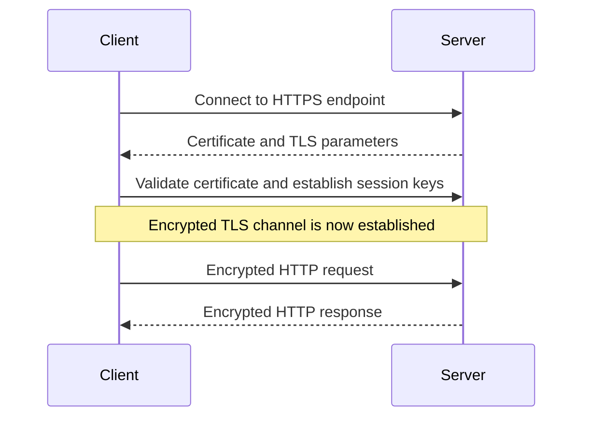
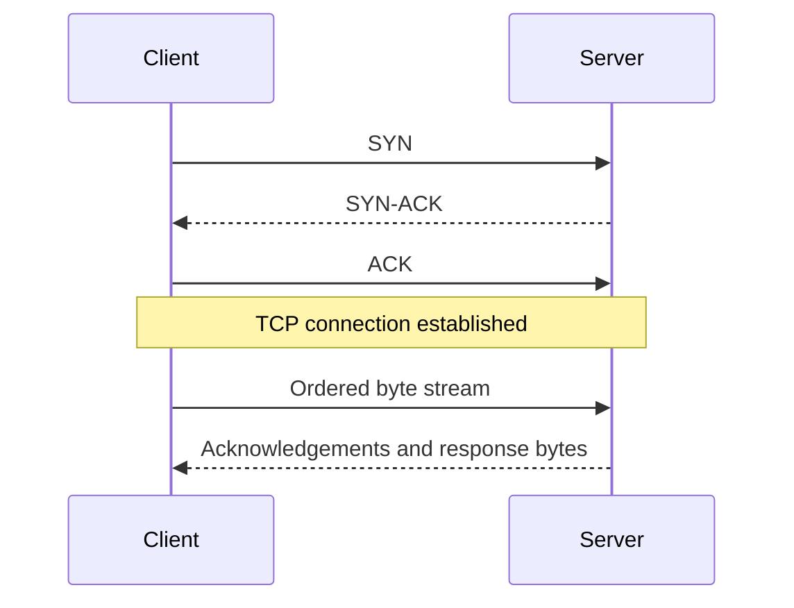
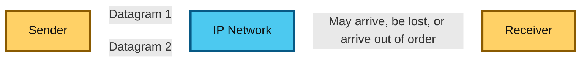
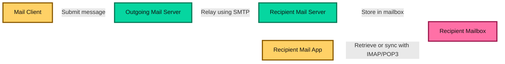
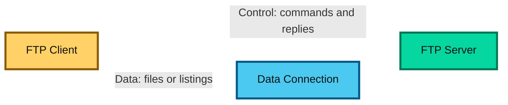
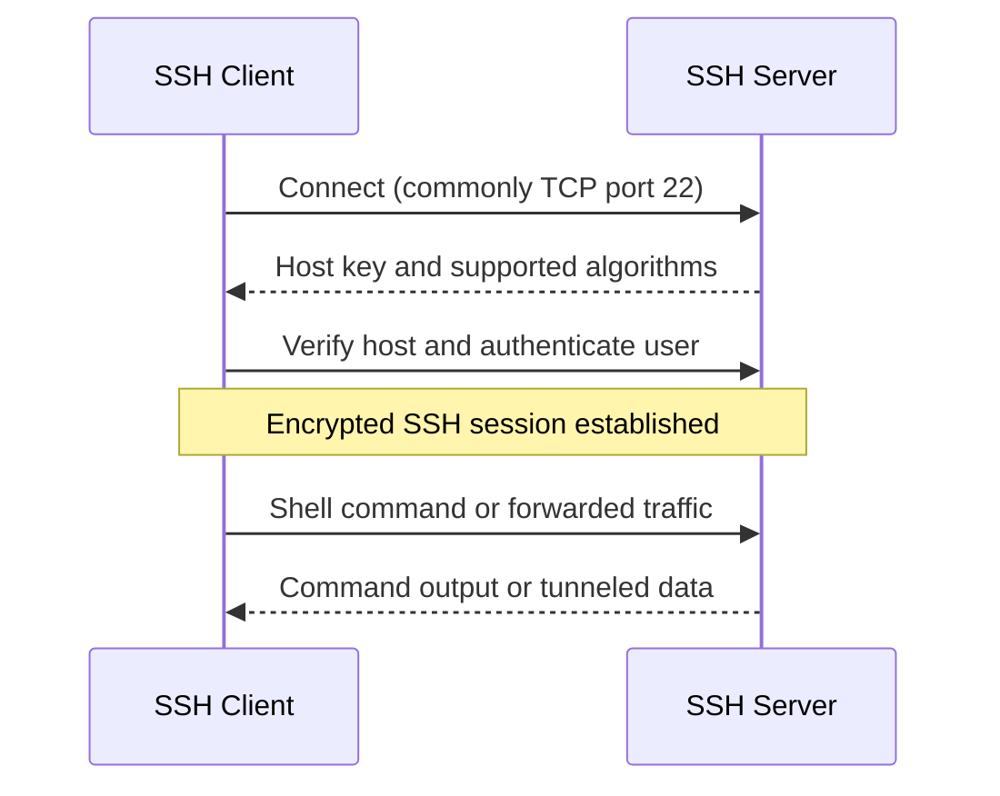
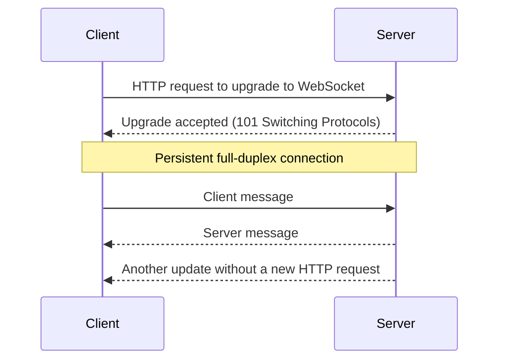
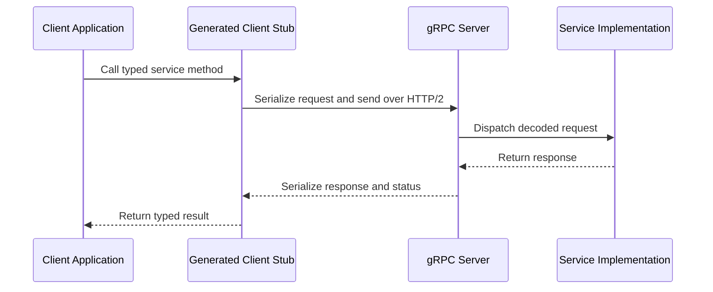

# Networking Protocols

This guide explains HTTP, HTTPS, TCP, UDP, SMTP, FTP, SSH, WebSocket, and gRPC. These protocols define how applications format messages, establish communication, transfer data, and secure connections. They operate at different layers, so a real application commonly uses several of them together.

## Why These Protocols Matter

When an application sends a request, multiple protocols cooperate. DNS may locate the destination, IP routes packets, TCP or UDP transports them, TLS can protect the channel, and an application protocol such as HTTP or gRPC defines what the messages mean. Knowing each protocol's responsibility helps when choosing an interface, diagnosing failures, and reasoning about latency, reliability, and security.

## How the Protocols Fit Together

The diagram is a simplified view. Not every application protocol uses TLS, and HTTP/3 runs over QUIC, which uses UDP while providing transport features such as reliable streams. The key distinction is that application protocols define the communication's meaning, while transport protocols move data between endpoints.

---

## 1. HTTP

### Concept

HTTP (Hypertext Transfer Protocol) is an application-layer protocol for exchanging requests and responses. It is the foundation of the web and is also widely used by APIs. A client sends a request containing a method, target, headers, and sometimes a body; a server returns a status code, headers, and sometimes a body.

HTTP is designed around resources identified by URLs. Methods such as `GET`, `POST`, `PUT`, `PATCH`, and `DELETE` express the action being requested. Status codes such as `200`, `404`, and `500` communicate the result. HTTP itself does not define how the network physically delivers bytes; it relies on a transport protocol underneath it.

HTTP is often described as stateless: each request should be understandable on its own, and the protocol does not automatically preserve application session state between requests. Applications can maintain state using cookies, tokens, server-side sessions, or other mechanisms.

### Request and response flow

### Versions

- HTTP/1.1 supports persistent connections, but requests on a connection can be constrained by response ordering and practical concurrency limits.
- HTTP/2 uses binary framing and multiplexes multiple streams over a single TCP connection. Packet loss on that TCP connection can still delay delivery of data across its streams.
- HTTP/3 uses HTTP semantics over QUIC, which runs over UDP and provides reliable, encrypted streams with improved handling of loss between independent streams.

### When to use it

Use HTTP for browser traffic, web applications, and many service APIs. Its broad support, clear request model, and mature tooling make it a practical default for communication across organizational or public network boundaries.

### Trade-offs

HTTP is widely supported and easy to inspect, but text-heavy headers and request-response interaction may not suit every workload. The application must also decide how to handle authentication, retries, caching, and state. HTTP alone does not encrypt traffic; use HTTPS for sensitive or public-network communication.

---

## 2. HTTPS

### Concept

HTTPS is HTTP communication protected by TLS (Transport Layer Security). TLS provides encryption in transit, integrity checks, and server authentication through certificates. This helps prevent network observers from reading or silently changing application data and helps the client verify that it connected to the intended server.

During connection setup, the client and server negotiate TLS parameters and establish shared session keys. The server presents a certificate, which the client validates against trusted certificate authorities and the requested hostname. After the secure channel is established, HTTP messages are carried inside it.

HTTPS does not make an application automatically secure. It protects data while it travels between TLS endpoints, but applications still need correct authorization, input validation, secure certificate management, and protection for data at rest. A TLS-terminating proxy can also mean that traffic is decrypted at that proxy before being forwarded internally.

### Secure request flow

### Common ports

- TCP port 443 is the standard port for HTTPS over HTTP/1.1 or HTTP/2.
- HTTP/3 commonly uses UDP port 443 for QUIC, though networks and deployments may use other configuration.

### When to use it

Use HTTPS for websites, APIs, authentication flows, and any communication that crosses a network you do not fully control. Modern public-facing services should use HTTPS by default.

### Trade-offs

TLS adds connection setup and computational work, although connection reuse and modern TLS versions reduce the cost. Certificates must be issued, renewed, and configured correctly. HTTPS protects the connection, not the application from vulnerabilities or misuse of data after it reaches the endpoint.

---

## 3. TCP

### Concept

TCP (Transmission Control Protocol) is a transport-layer protocol that provides a reliable, ordered byte stream between two endpoints. Applications send bytes; TCP divides them into segments, tracks what has been delivered, retransmits lost data, and presents the bytes in order to the receiving application.

Before sending application data, TCP normally establishes a connection with a three-way handshake: the client sends `SYN`, the server replies with `SYN-ACK`, and the client responds with `ACK`. TCP also uses flow control to avoid overwhelming a receiver and congestion control to adapt sending behavior to network conditions.

TCP preserves the order of bytes, but it does not preserve application message boundaries. If an application writes two messages, the receiver may read them in several chunks or together; the application protocol must frame its messages.

### Connection establishment

### When to use it

Use TCP when the application needs reliable, ordered delivery and can tolerate retransmissions and connection setup. HTTP/1.1, HTTP/2, SMTP, SSH, and many database protocols commonly use TCP.

### Trade-offs

TCP handles loss and ordering for the application, simplifying many systems. The cost is connection state, retransmission delay, and head-of-line blocking within a TCP byte stream when data is lost. TCP provides no encryption by itself; protocols such as HTTPS and SSH add security at higher layers.

---

## 4. UDP

### Concept

UDP (User Datagram Protocol) is a transport-layer protocol that sends independent datagrams without establishing a connection. It does not guarantee delivery, ordering, or duplicate protection, and it has a small header with little transport-level overhead.

Because UDP does not perform retransmission or ordering for the application, a lost datagram is generally not recovered by UDP itself. Applications can choose to tolerate loss, add their own reliability mechanisms, or send newer data instead of waiting for old data. UDP does not inherently mean "faster" in every situation; the application's behavior and network conditions determine real performance.

QUIC is an important example of a protocol built on UDP. QUIC adds encrypted, reliable streams and other transport behavior above UDP, while benefiting from a transport design that can evolve in user space.

### Datagram flow

### When to use it

Use UDP when low overhead or timely delivery is more important than guaranteed delivery of every packet, or when the application implements its own reliability. Common examples include DNS queries, real-time voice and video, many online games, and QUIC-based HTTP/3.

### Trade-offs

UDP avoids transport-level connection setup and retransmission, which can benefit latency-sensitive traffic. The application must handle loss, ordering, congestion, and security as needed. UDP traffic is also more likely to be restricted by firewalls or network policies in some environments.

---

## 5. SMTP

### Concept

SMTP (Simple Mail Transfer Protocol) is an application-layer protocol used to submit and relay outgoing email. A mail client submits a message to an outgoing mail server, which may relay it through other mail servers until it reaches the recipient's mail provider.

SMTP is a store-and-forward system: a sending server can accept a message and attempt delivery later. Delivery is not necessarily immediate, and a message may be retried or returned as undeliverable. SMTP handles sending and relaying; users typically retrieve or synchronize received mail using other protocols such as IMAP or POP3.

### Mail delivery flow

### Common ports

- TCP port 25 is primarily used for mail transfer between servers.
- TCP port 587 is commonly used for authenticated message submission, typically with STARTTLS.
- TCP port 465 is commonly used for message submission with implicit TLS.

### When to use it

Use SMTP when an application needs to send transactional email, notifications, or user-submitted messages through a mail service or mail server.

### Trade-offs

SMTP is broadly supported and handles relaying and retry behavior, but delivery can be delayed, rejected, or classified as spam. Applications should handle provider errors, bounce notifications, rate limits, and reputation requirements. Use TLS and authenticated submission rather than sending credentials or messages in plaintext.

---

## 6. FTP

### Concept

FTP (File Transfer Protocol) is an application-layer protocol for transferring files between a client and a server. Traditional FTP uses a control connection for commands and a separate data connection for file contents or directory listings.

In active mode, the server opens the data connection back to the client. In passive mode, the client opens both connections, which is generally easier to support through NAT and client-side firewalls. The separate control and data channels are one reason FTP configuration can be more complicated than a single-connection protocol.

Traditional FTP does not encrypt credentials or file contents. FTPS adds TLS to FTP, while SFTP is a separate file-transfer protocol that runs over SSH; the names are similar, but SFTP is not FTP secured by TLS.

### Two-channel model

### When to use it

Use FTP only when a system specifically requires it and the network and security configuration are understood. For new systems, prefer SFTP or a secure HTTPS-based upload/download service.

### Trade-offs

FTP is widely understood and supports file operations, but traditional FTP is unencrypted and its separate data channel can complicate firewalls and NAT. FTPS and SFTP address different security and transport models; verify which protocol a server actually supports.

---

## 7. SSH

### Concept

SSH (Secure Shell) is a protocol for securely accessing and operating a remote system over an untrusted network. It establishes an encrypted channel and supports server authentication, client authentication, interactive shell access, remote command execution, and port forwarding.

The client verifies the server's host key to reduce the risk of connecting to an impersonated server. The user then authenticates, commonly with a public/private key pair or another configured method. Once established, the encrypted session can carry terminal input, command output, or forwarded network traffic.

SFTP and SCP are file-transfer tools/protocols associated with the SSH ecosystem. SFTP is not the same protocol as FTP, even though both transfer files.

### Secure session flow

### When to use it

Use SSH for remote server administration, secure command execution, Git access over SSH, and encrypted tunneling or port forwarding.

### Trade-offs

SSH provides strong protection when host keys and credentials are managed correctly. Poor key management, shared accounts, or accepting unknown host keys can undermine that protection. Exposed SSH services should use strong authentication, least privilege, and appropriate network restrictions.

---

## 8. WebSocket

### Concept

WebSocket provides a persistent, full-duplex communication channel between a client and a server. After an initial HTTP-based handshake establishes the connection, either side can send messages at any time without starting a new HTTP request for each update.

This is useful when an application needs ongoing, low-latency updates in both directions. Examples include chat, collaborative editing, live dashboards, multiplayer games, and notifications. WebSocket messages can be text or binary, and the application defines their payload format and meaning.

The `ws://` scheme is unencrypted; `wss://` uses TLS. The connection remains open until it is closed by the client, server, or network, so systems must consider authentication, heartbeats, reconnection, and connection capacity.

### Upgrade and message flow

### When to use it

Use WebSocket when both client and server need to exchange frequent, time-sensitive messages over a long-lived connection. For one-way server updates, Server-Sent Events may be simpler; for occasional client requests, ordinary HTTP is usually simpler.

### Trade-offs

WebSocket avoids repeated request setup and supports bidirectional communication, but long-lived connections consume server resources and require connection lifecycle management. Reconnection, load balancing, fan-out, authorization changes, and message delivery guarantees need explicit design. WebSocket itself does not guarantee that application messages are persisted or delivered exactly once.

---

## 9. gRPC

### Concept

gRPC is a remote procedure call (RPC) framework that lets a client invoke operations exposed by a server through a defined service contract. Service methods and message types are commonly described with Protocol Buffers (`.proto` files), from which client and server code can be generated.

A client calls a generated stub as if it were invoking a local method, but the call is serialized, sent over the network, handled by the server, and returned as a response. Standard gRPC commonly uses HTTP/2, Protocol Buffers, and TLS. It supports unary calls, client streaming, server streaming, and bidirectional streaming.

The RPC abstraction makes service-to-service communication strongly structured, but a remote call is not equivalent to a local function call. It can fail because of network timeouts, server errors, retries, or partial outages, so clients still need deadlines, cancellation, and error handling.

### RPC flow

### When to use it

Use gRPC for strongly typed communication between services, especially when efficient serialization, generated client code, streaming, or cross-language contracts are valuable. It is common in internal microservice and platform APIs.

### Trade-offs

gRPC provides compact messages and a clear contract, but browser support and human readability can be less convenient than conventional JSON-over-HTTP. Gateways or gRPC-Web may be needed for browser clients. Teams must manage schema evolution, deadlines, retries, and compatibility carefully. HTTP/2 support is required for the common gRPC transport.

---

## Quick Comparison

| Protocol | Layer / role | Typical transport | Typical use |
| --- | --- | --- | --- |
| HTTP | Application request/response | TCP for HTTP/1.1 and HTTP/2; QUIC over UDP for HTTP/3 | Websites and APIs |
| HTTPS | HTTP protected with TLS | Usually TCP; QUIC for HTTP/3 | Secure websites and APIs |
| TCP | Reliable, ordered byte stream | Transport protocol over IP | Web, mail, SSH, databases |
| UDP | Connectionless datagrams | Transport protocol over IP | Real-time traffic, DNS, QUIC transport |
| SMTP | Outgoing mail submission and relay | Usually TCP | Sending and relaying email |
| FTP | File transfer with control and data channels | Usually TCP | Legacy file transfer |
| SSH | Encrypted remote access and tunneling | Usually TCP | Administration, secure command execution |
| WebSocket | Persistent, bidirectional application channel | TCP, commonly protected with TLS for WSS | Chat and live updates |
| gRPC | Contract-based RPC framework | Commonly HTTP/2 over TCP, often with TLS | Service-to-service communication |

## Important Distinctions

- HTTP and HTTPS describe application communication; TCP and UDP describe transport behavior.
- HTTPS means HTTP protected by TLS. TCP alone does not provide encryption.
- HTTP/3 uses QUIC over UDP, but that does not make HTTP/3 unreliable; QUIC implements reliable streams above UDP.
- SMTP sends and relays email. IMAP and POP3 are commonly used to retrieve or synchronize mailboxes.
- FTPS is FTP protected with TLS. SFTP is a distinct protocol that operates over SSH.
- WebSocket begins with an HTTP handshake, then uses a persistent bidirectional connection.
- gRPC is an RPC framework and message contract model, commonly transported over HTTP/2; it is not simply a different spelling of REST.

## Final Takeaway

Choose a protocol based on the communication pattern and operational constraints. TCP is a good default when reliable ordered delivery is needed; UDP is useful when the application needs low overhead or builds its own transport behavior. HTTP and gRPC provide different application-level interaction models, WebSocket supports ongoing bidirectional updates, SMTP handles outgoing mail, FTP is primarily a legacy file-transfer option, and SSH provides secure remote access and tunneling. Security, timeouts, retries, and compatibility remain part of the system design around every protocol.
