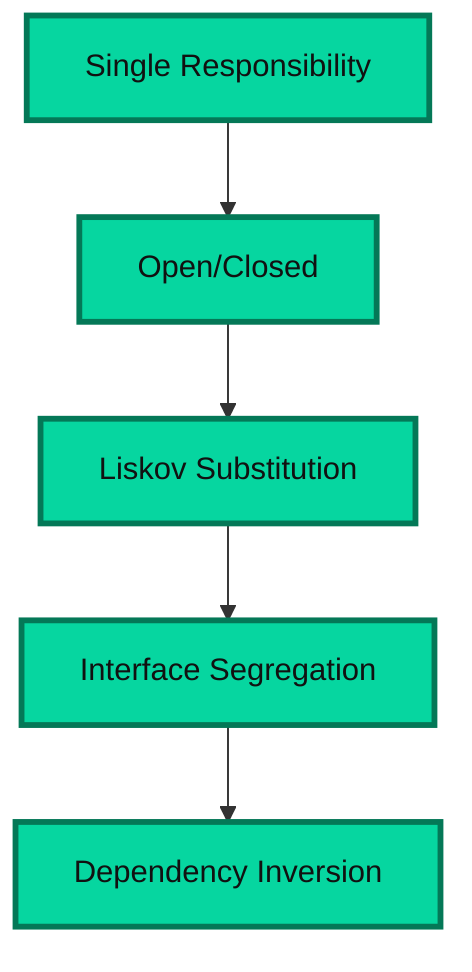

# Software Design Principles

This guide explains the most important design principles that help teams build code that is maintainable, scalable, and easier to evolve. These principles are especially useful in system design, backend services, and large application codebases where change is constant.

## Why Design Principles Matter

Good software is not only about making it work. Real-world systems must be easy to understand, easy to extend, safe to modify, and resilient when requirements change. Design principles help developers avoid tightly-coupled code, duplicate logic, and unnecessary complexity.

A strong design principle answers a simple question:

> How do we write software that remains useful as the system grows?

---

## 1. SOLID Principles

SOLID is a set of five object-oriented design principles that guide software architecture and maintainability. The goal is to make code understandable, flexible, and resistant to breaking when new features are added.

### Diagram



### 1.1 Single Responsibility Principle (SRP)

### Concept

A class or module should have one reason to change.

In simple terms, a component should do only one job and not mix unrelated responsibilities. If a class handles both database access and user notification logic, it becomes difficult to change one part without risking the other.

### Why it matters

- Easier to test
- Easier to maintain
- Fewer side effects during change
- Better module boundaries

### Example

Bad design:

```ts
class UserService {
  createUser(user) {
    // validate input
    // save to database
    // send welcome email
  }
}
```

This class does validation, persistence, and email processing. If email logic changes, the user creation flow is affected.

Better design:

```ts
class UserRepository {
  save(user) { /* database logic */ }
}

class EmailService {
  sendWelcomeEmail(user) { /* email logic */ }
}

class UserService {
  constructor(userRepository, emailService) {
    this.userRepository = userRepository;
    this.emailService = emailService;
  }

  createUser(user) {
    this.userRepository.save(user);
    this.emailService.sendWelcomeEmail(user);
  }
}
```

### Explanation

The user service coordinates business behavior while each specialized class owns one responsibility. The design becomes easier to extend and reason about.

---

### 1.2 Open/Closed Principle (OCP)

### Concept

Software entities should be open for extension but closed for modification.

This means you should be able to add behavior without altering existing working code. Instead of changing a class directly, you extend it through new classes, strategies, or abstractions.

### Why it matters

- Encourages reusable code
- Reduces regression risks
- Supports feature growth without rewriting old logic

### Example

```ts
class PaymentProcessor {
  process(type, amount) {
    if (type === 'card') {
      return 'Card payment';
    }

    if (type === 'upi') {
      return 'UPI payment';
    }

    throw new Error('Unsupported payment method');
  }
}
```

This version is closed to extension because every new payment method requires modifying the same function.

Better approach:

```ts
interface PaymentMethod {
  process(amount: number): string;
}

class CardPayment implements PaymentMethod {
  process(amount: number) {
    return `Card payment: ${amount}`;
  }
}

class UPIPayment implements PaymentMethod {
  process(amount: number) {
    return `UPI payment: ${amount}`;
  }
}
```

### Explanation

New payment methods can be added by implementing a common interface without modifying the existing payment processor logic.

---

### 1.3 Liskov Substitution Principle (LSP)

### Concept

Objects of a superclass should be replaceable with objects of its subclasses without breaking the system.

If a subclass changes the behavior of a parent in a surprising or inconsistent way, the design violates LSP.

### Why it matters

- Prevents broken inheritance hierarchies
- Makes polymorphism reliable
- Keeps subclass behavior predictable

### Example

```ts
class Bird {
  fly() {
    return 'Flying';
  }
}

class Sparrow extends Bird {}
```

This works for birds that fly. But if we create:

```ts
class Penguin extends Bird {
  fly() {
    throw new Error('Penguins cannot fly');
  }
}
```

This breaks the parent contract because the subclass violates the expected behavior of `Bird`.

### Explanation

A subclass should not weaken or redefine inherited behavior in ways that contradict the parent’s contract. Good inheritance preserves expected behavior and semantics.

---

### 1.4 Interface Segregation Principle (ISP)

### Concept

Clients should not be forced to depend on interfaces they do not use.

Large interfaces create unnecessary coupling. Instead of one big interface, split responsibilities into smaller and more focused ones.

### Why it matters

- Reduces unnecessary dependencies
- Makes classes easier to implement and test
- Avoids irrelevant methods on clients

### Example

Bad design:

```ts
interface Machine {
  print(): void;
  scan(): void;
  fax(): void;
}

class SimplePrinter implements Machine {
  print() {}
  scan() { throw new Error('Not supported'); }
  fax() { throw new Error('Not supported'); }
}
```

Better design:

```ts
interface Printer {
  print(): void;
}

interface Scanner {
  scan(): void;
}

class SimplePrinter implements Printer {
  print() {}
}
```

### Explanation

A printer should not be forced to implement scanning or fax logic. Smaller interfaces keep responsibilities aligned with actual use cases.

---

### 1.5 Dependency Inversion Principle (DIP)

### Concept

High-level modules should not depend on low-level modules. Both should depend on abstractions.

This means business logic should depend on interfaces or abstractions rather than concrete implementations that may change often.

### Why it matters

- Reduces tight coupling
- Improves testability
- Supports different implementations with minimal code changes

### Example

```ts
class MySQLDatabase {
  save() { /* database logic */ }
}

class UserService {
  constructor() {
    this.db = new MySQLDatabase();
  }
}
```

This is tightly coupled to MySQL. A switch to PostgreSQL would require code changes.

Better design:

```ts
interface Database {
  save(): void;
}

class MySQLDatabase implements Database {
  save() {}
}

class UserService {
  constructor(private db: Database) {}
}
```

### Explanation

The service depends on a contract, not a concrete database implementation. This supports flexibility and easier replacement.

---

### SOLID Summary

SOLID helps engineers build software that is:

- Easy to reason about
- Easy to change safely
- Useful across growing systems
- Less prone to fragile designs

---

## 2. DRY - Don’t Repeat Yourself

### Concept

Avoid duplication of logic, knowledge, or design in multiple places.

If the same logic is repeated in several classes or functions, the code becomes harder to maintain and easier to break when requirements change.

### Why it matters

- Less maintenance effort
- Fewer inconsistent implementations
- Easier refactoring

### Example

```ts
function calculateTax(amount: number) {
  return amount * 0.18;
}

function computeInvoiceTax(amount: number) {
  return amount * 0.18;
}
```

Both functions duplicate the same formula. The logic should live in one place.

Better design:

```ts
function calculateTax(amount: number) {
  return amount * 0.18;
}
```

### Explanation

DRY does not mean eliminating all repetition in the codebase. It means avoiding duplicated business logic or duplicated intent. Sometimes small duplication can be acceptable if it improves clarity. The key is to avoid repeated knowledge that must be kept in sync.

### Common violations

- Copy-pasting validation logic across multiple modules
- Duplicate database queries in several services
- Repeating the same transformation in multiple controllers

### Trade-off

Over-application of DRY can lead to over-engineering. Not every repeated snippet should be abstracted into a shared utility. The right abstraction should reduce duplication without making the code harder to understand.

---

## 3. KISS - Keep It Simple, Stupid

### Concept

Prefer the simplest solution that solves the problem clearly and correctly.

Complex design is not automatically better. A system that is easy to understand and maintain is usually a better engineering choice than one that is clever but difficult to reason about.

### Why it matters

- Easier debugging
- Lower maintenance cost
- More reliable code
- Better onboarding for new developers

### Example

Instead of building a complicated distributed workflow for a simple local feature, sometimes a direct synchronous function is enough.

```ts
function getUserName(user) {
  return user.name;
}
```

This is simpler than building a full abstraction layer just to access one field.

### Explanation

KISS encourages clarity and practical problem-solving. Overengineering creates more moving parts than needed. The best solution is often the one the team can understand, operate, and modify without friction.

### Rule of thumb

If the problem is simple, do not invent a complex architecture. Solve the actual need directly.

---

## 4. YAGNI - You Aren’t Gonna Need It

### Concept

Do not add functionality or abstractions that are not required yet.

A lot of unnecessary code is introduced because teams anticipate future requirements that may never appear. YAGNI encourages building only what is needed for the current problem.

### Why it matters

- Reduces waste
- Keeps scope focused
- Avoids overbuilt abstractions
- Saves time and cost

### Example

If the current requirement is to upload a single image, do not build a full media transformation pipeline with resizing, transcoding, CDN optimization, and versioning unless those features are already required.

### Explanation

YAGNI complements KISS. The idea is not to avoid planning, but to avoid speculative design. Build the smallest useful thing first, then evolve it when real requirements appear.

### When YAGNI is violated

- Creating a generic framework before there is a real use case
- Adding many configuration options for imagined future scenarios
- Introducing layers of abstraction before they are proven necessary

### Good practice

Build for the current requirement. Revisit the design when actual usage and constraints become clear.

---

## 5. How These Principles Work Together

These principles do not compete with each other; they reinforce one another.

- SOLID helps organize responsibilities and dependencies
- DRY reduces duplicated logic and repeated business knowledge
- KISS keeps the design understandable and practical
- YAGNI prevents unnecessary complexity and speculative features

Together, they help teams create software that is maintainable, scalable, and less fragile.

### Example Relationship

A system may start simple and then evolve:

1. Write a straightforward implementation using KISS.
2. Refactor repeated logic using DRY where it adds real value.
3. Split responsibilities using SOLID as the system grows.
4. Avoid adding extra features not currently needed by following YAGNI.

---

## 6. Practical Interview and Design View

In system design and engineering interviews, these principles are evaluated by how well the candidate reasons about complexity and maintainability.

Typical interview expectations:

- Separate concerns instead of mixing responsibilities
- Avoid over-engineering because the system should evolve with real needs
- Keep interfaces and code simple enough to read and maintain
- Reuse logic carefully without creating fragile generic abstractions

Good answers often mention:

> "I would keep the code modular and focused, avoid premature abstraction, and only add complexity when the requirement or scale actually demands it."

---

## 7. Final Takeaway

Software design principles are not strict rules that must be followed blindly. They are mental tools for making better decisions.

The short version is:

- SOLID: structure code around responsibilities and abstractions
- DRY: do not duplicate important logic
- KISS: prefer clarity over cleverness
- YAGNI: do not build for imaginary requirements

The best engineering teams balance simplicity with flexibility. They keep the system understandable now while making it ready for the future without adding unnecessary complexity.

> Good design is not the most complicated design. It is the design that solves the real problem clearly, safely, and sustainably.
